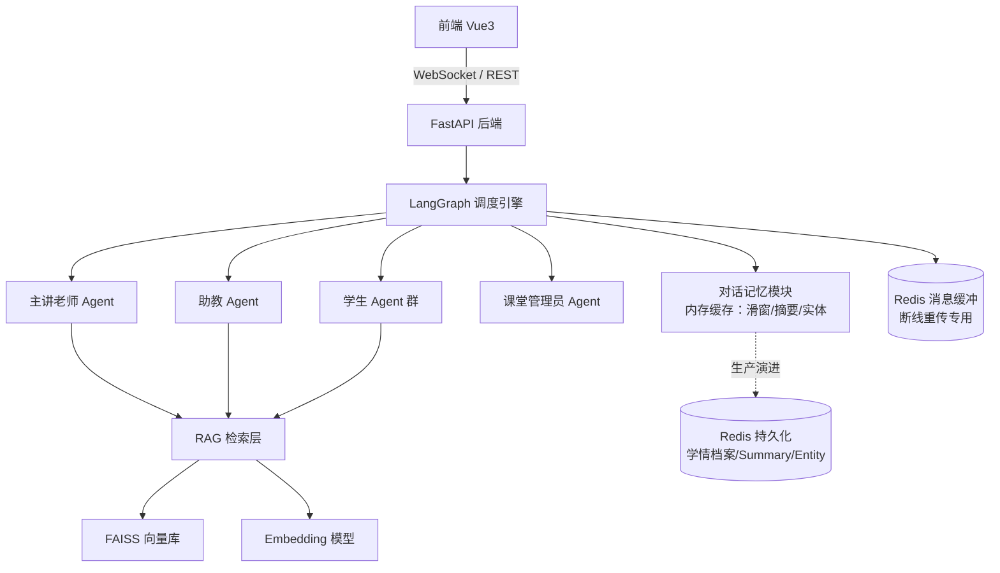
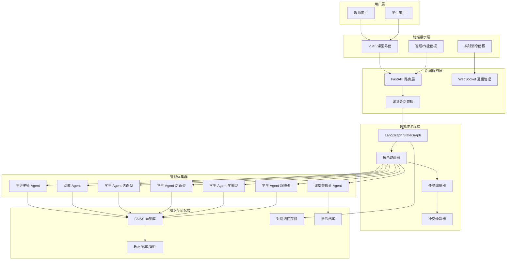
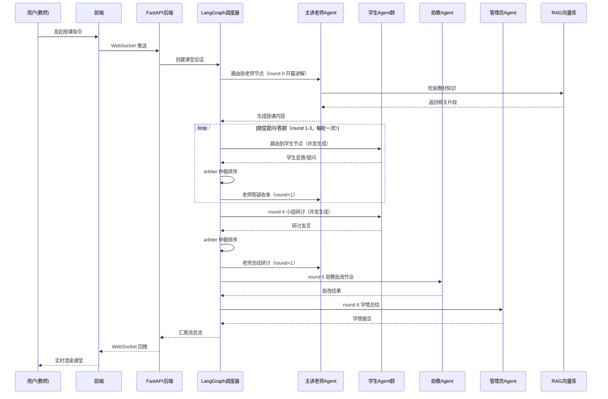
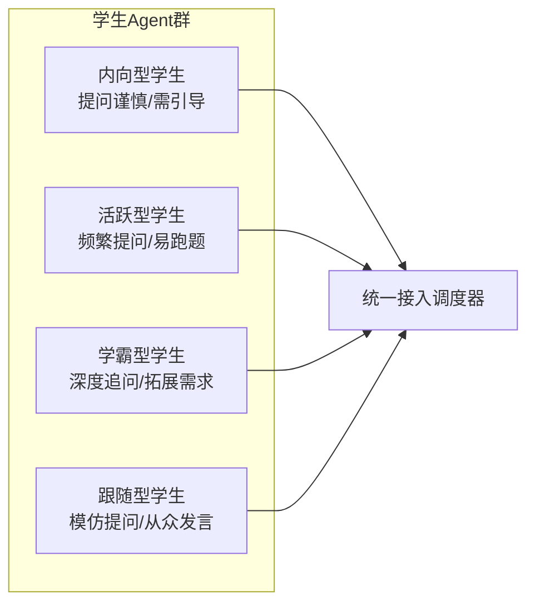
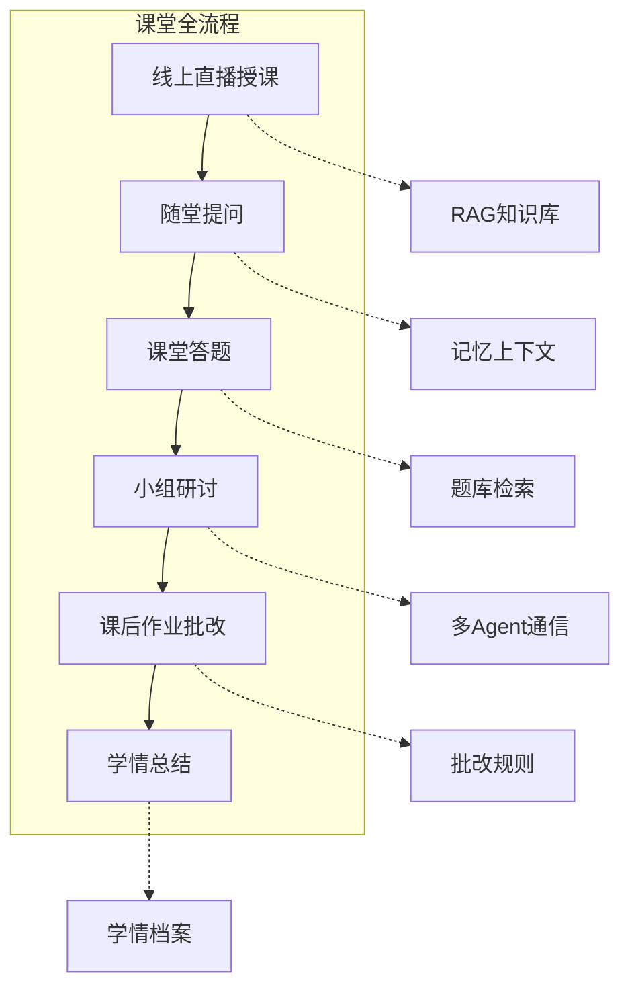
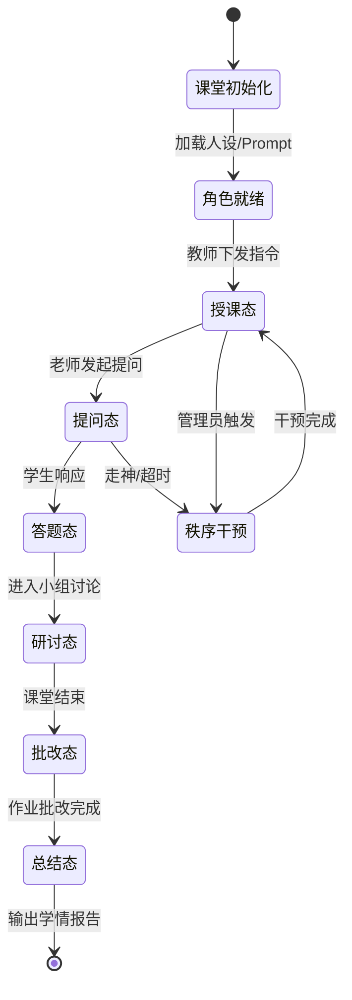
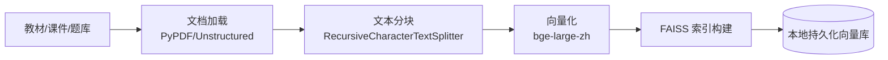
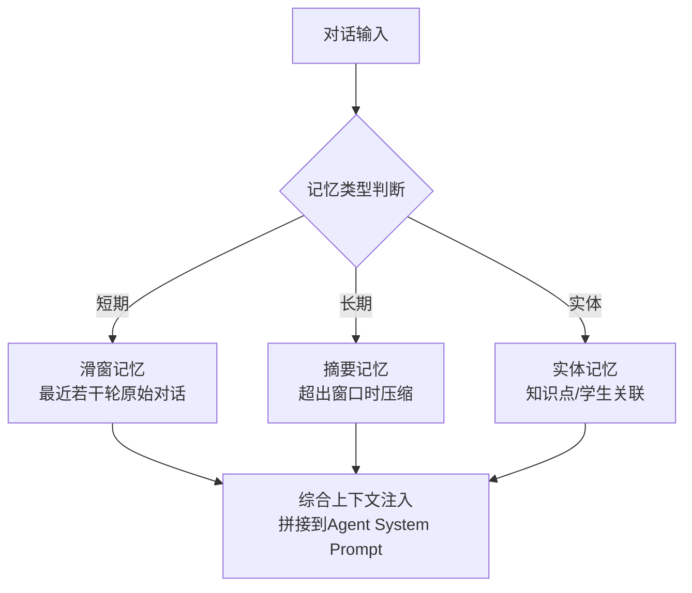
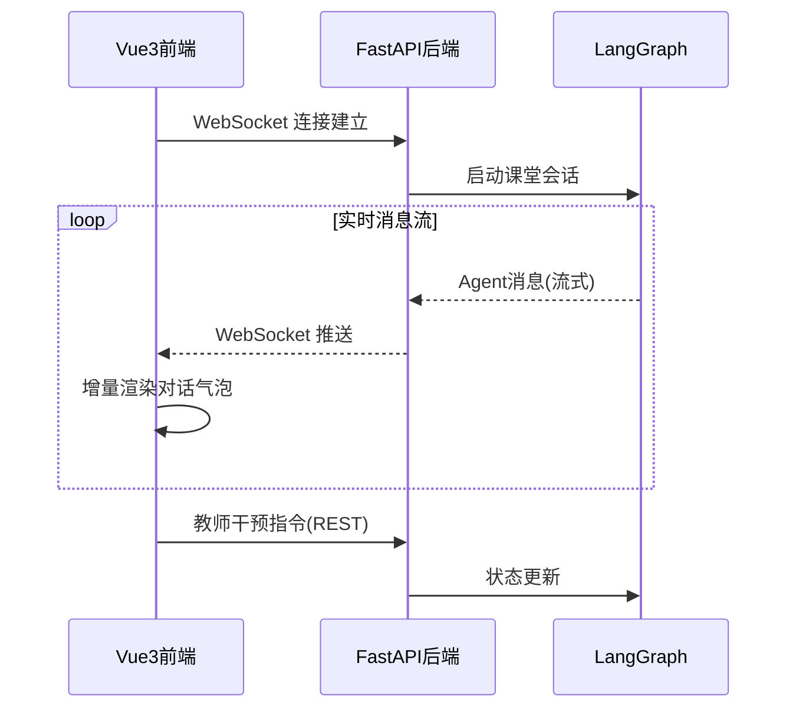
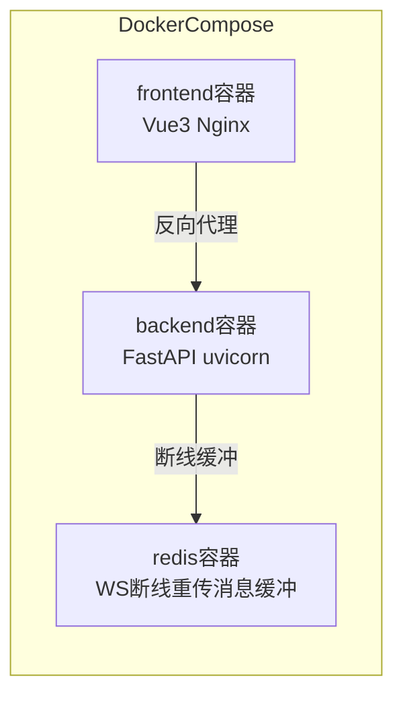

# AI Classroom 多智能体互动教学课堂

> 项目技术文档
> 版本：v1.0 ｜ 更新日期：2026-08-17

---

## 目录

1. [项目概述](#一项目概述)
2. [技术栈选型](#二技术栈选型)
3. [系统架构设计](#三系统架构设计)
4. [核心角色定义](#四核心角色定义)
5. [核心功能模块](#五核心功能模块)
6. [关键技术实现](#六关键技术实现)
7. [技术攻坚与踩坑实录](#七技术攻坚与踩坑实录)
8. [项目性能自测数据](#八项目性能自测数据)
9. [项目亮点](#九项目亮点)
10. [项目演进与优化方向](#十项目演进与优化方向)

---

## 一、项目概述

### 1.1 项目背景

当前在线教育场景中，AI 辅助教学多以"单 Agent + 知识库问答"模式为主，难以还原真实课堂中"师生互动、生生研讨、秩序管控"的多角色协同生态。传统方案存在以下痛点：

- **角色单一**：仅有一个 AI 助手，无法模拟真实课堂中老师、助教、学生等多角色协同；
- **上下文割裂**：缺乏跨轮对话记忆，学生提问无法关联前文知识点；
- **内容不可控**：LLM 凭空生成内容，存在"幻觉"风险，授课严谨性无法保障；
- **秩序缺失**：缺少课堂秩序管控（走神提醒、举手发言、超时限制），难以维持教学节奏。

### 1.2 项目目标

基于 **LangGraph 多智能体调度框架** + **RAG 向量检索** + **对话记忆机制**，搭建一套还原真实课堂全流程的 AI 多智能体互动教学系统，实现：

| 目标 | 说明 |
|------|------|
| 多角色协同 | AI 主讲老师、助教、多名性格差异化学生智能体、课堂管理员协同工作 |
| 全流程闭环 | 线上直播授课 → 随堂提问 → 课堂答题 → 小组研讨 → 课后作业批改 → 学情总结 |
| 内容可控 | 授课内容全部依托 RAG 知识库生成，杜绝凭空编造 |
| 秩序管控 | 走神提醒、举手发言机制、课堂超时限制 |

### 1.3 项目价值

- **技术深度**：覆盖多智能体通信冲突、任务编排、角色边界管控等前沿难题；
- **场景稀缺**：市面极少多 Agent 课堂场景实现，具备差异化竞争力；
- **工程闭环**：从智能体调度到前端交互、Docker 云端部署的完整工程链路。

### 1.4 个人职责与代码实现

本人独立完成本项目的方案设计与编码实现（除前端 Vue3 页面样式外），核心代码产出如下：

| 模块 | 文件 | 代码量 | 主要工作 |
|------|------|--------|----------|
| LangGraph 编排层 | `graph/state.py`、`graph/workflow.py` | ~300 行 | 在 `state.py` 定义 `ClassroomState` 状态机，在 `workflow.py` 编写 `route_by_phase` 条件路由函数，编排老师/学生/助教/管理员/仲裁器 5 类节点跳转 |
| RAG 检索服务 | `retriever.py` | ~150 行 | 用 `RecursiveCharacterTextSplitter` 处理 PDF，封装 FAISS 向量检索 + BM25 混合检索，处理空检索兜底 |
| 多智能体并发控制 | `speaker_queue.py` | ~80 行 | 基于 `asyncio.Lock` 实现发言锁，编写 `SpeakerQueue` 优先级队列，解决多人同时抢答时的消息覆盖 |
| 后端 API 层 | `main.py` | ~200 行 | 建立 WebSocket 连接管理池，处理心跳包与断线重连，封装 LLM 调用重试装饰器 |
| Agent Prompt 与记忆 | `agents/*.py` | ~250 行 | 编写 4 类角色 System Prompt（含 JSON 结构化输出约束），集成 `LayeredMemory` 三层记忆 |

核心后端代码约 1000 行（不含前端页面样式与配置文件），涵盖调度编排、RAG 检索、Agent 实现与 API 层，全部由本人编写与调试。其中 LangGraph 状态机与路由逻辑约 300 行，RAG 混合检索约 150 行，Agent Prompt 与角色逻辑约 250 行，API 与 WebSocket 管理约 200 行，其余为工具类与配置。

---

## 二、技术栈选型

### 2.1 整体技术栈

| 层级 | 技术选型 | 选型理由 |
|------|----------|----------|
| 智能体调度 | LangGraph | 原生支持 StateGraph 状态机，适合多 Agent 编排与条件路由 |
| LLM 接入 | LangChain + 阿里百炼 Qwen（OpenAI 兼容） | LangChain 提供 Prompt/Chain/Memory 抽象，便于开发与切换模型 |
| 向量检索 | FAISS | 开源、本地部署、上手简单，适合中小规模知识库 |
| 嵌入模型 | bge-large-zh | 中文语义检索效果较好，可本地部署 |
| 后端框架 | FastAPI | 异步高性能，自带 OpenAPI 文档，便于前端对接 |
| 前端框架 | Vue3 + Vite + Element Plus | 组件丰富、开发效率高，对话气泡等组件可直接复用 |
| 实时通信 | WebSocket | 支持课堂直播式实时消息推送 |
| 容器化 | Docker + Docker Compose | 一键部署，环境隔离，便于交付 |

### 2.2 依赖关系图



---

## 三、系统架构设计

### 3.1 整体架构图



### 3.2 多智能体调度流程



---

## 四、核心角色定义

每个 Agent 拥有独立人设、权限边界、提示词约束，由 LangGraph 的节点函数承载。

### 4.1 角色权限矩阵

| 角色 | 人设定位 | 核心职责 | 权限边界 |
|------|----------|----------|----------|
| AI 主讲老师 | 严谨博学的学科专家 | 授课内容生成、知识点讲解、随堂提问设计 | 可调用 RAG 检索；不可批改作业；不可管控秩序 |
| 助教 Agent | 耐心细致的辅导者 | 答疑解惑、作业批改、补充资料检索 | 可检索知识库；不可发起授课；不可中断课堂 |
| 学生 Agent 群 | 性格差异化（内向/活跃/学霸/跟随） | 模拟真实学生提问、研讨、答题 | 只能被动响应或举手发言；不可主动控场 |
| 课堂管理员 | 中立秩序维护者 | 走神提醒、举手排队、超时限制、冲突仲裁 | 可中断非秩序发言；不可生成学科内容 |

### 4.2 学生智能体性格差异化设计



**性格参数化设计**（在 System Prompt 中约束）：

- `active_probability`：主动发言概率
- `question_depth`：提问深度档位（浅层/中层/深层）
- `off_topic_risk`：跑题风险系数
- `response_latency`：响应延迟（模拟真实思考时间）

---

## 五、核心功能模块

### 5.1 功能全景



### 5.2 模块说明

#### 模块一：线上直播授课

- **触发方式**：教师下发"开始授课"指令，指定主题与章节；
- **执行流程**：主讲老师 Agent 调用 RAG 检索教材片段 → 按教学大纲分段生成授课内容 → WebSocket 实时推流；
- **秩序约束**：管理员 Agent 监控时长，接近超时主动提醒收束。

#### 模块二：随堂提问

- **发起方**：主讲老师 Agent 根据知识点自动生成提问；
- **响应方**：被点名学生 Agent 回答，其他学生 Agent 处于"旁听态"；
- **记忆关联**：提问内容写入对话记忆，后续回答可关联前文。

#### 模块三：课堂答题

- **题源**：从 RAG 题库检索匹配知识点的题目；
- **答题机制**：学生 Agent 作答 → 助教 Agent 批改 → 老师点评；
- **数据落库**：答题记录写入学情档案。

#### 模块四：小组研讨

- **分组策略**：管理员 Agent 按"性格互补"原则分组（避免同质化）；
- **通信机制**：组内学生 Agent 单轮并行研讨（按性格互补分组后，在同一轮内 `asyncio.gather` 生成）→ 仲裁器排序 → 老师总结；
- **冲突处理**：多 Agent 同时发言时，由冲突仲裁器按优先级排队。

#### 模块五：课后作业批改

- **批改主体**：助教 Agent；
- **批改依据**：RAG 检索标准答案 + 评分规则 Prompt；
- **反馈机制**：生成逐题点评，写入学情档案。

#### 模块六：学情总结

- **数据来源**：对话记忆 + 答题记录 + 研讨表现；
- **输出生成**：管理员 Agent 汇总 → 输出结构化学情报告（薄弱点、掌握度、建议）。

---

## 六、关键技术实现

### 6.1 基于 LangGraph 的多智能体调度

#### 6.1.1 状态图设计



> 状态图简化了节点跳转细节，便于理解课堂整体流程。实际实现中（见 6.1.2），`提问态` 与 `研讨态` 会路由到 `student` 节点并发生成，再由 `arbiter` 归并后回到 `授课态`（teacher），形成 `teacher → student → arbiter → teacher` 的闭环。

#### 6.1.2 核心调度逻辑实现

```python
from typing import TypedDict, Annotated
from langgraph.graph import StateGraph, END
import operator

# 课堂共享状态：messages 用 operator.add 增量合并，避免覆盖历史
class ClassroomState(TypedDict):
    messages: Annotated[list, operator.add]  # 对话历史（追加式）
    new_messages: list                       # 学生节点本次新增、待仲裁器排序的消息（覆盖式）
    current_speaker: str                     # 当前发言角色
    phase: str                               # 课堂阶段
    topic: str                               # 授课主题
    memory: dict                             # 记忆上下文
    order_alerts: Annotated[list, _merge_order_alerts]  # 秩序告警（追加 + 可清空）
    round: int                               # teacher 执行轮次（单调递增）

# 构建状态图：每个节点对应一类 Agent
graph = StateGraph(ClassroomState)
graph.add_node("teacher", teacher_node)
graph.add_node("student", student_group_node)  # 学生群节点
graph.add_node("ta", ta_node)
graph.add_node("manager", manager_node)
graph.add_node("arbiter", arbiter_node)         # 仲裁器节点

# 条件路由：根据课堂轮次（round）与告警决定下一节点
# 注意：映射表的 key 必须是 route_by_phase 返回的「节点名」，不是 phase 名
graph.add_conditional_edges(
    "teacher",
    route_by_phase,
    {
        "teacher": "teacher",
        "student": "student",
        "ta": "ta",
        "manager": "manager",
        END: END,
    },
)
# 学生并发生成完后，由仲裁器归并排序
graph.add_edge("student", "arbiter")
# 仲裁器归并完，控制权交回老师继续授课
graph.add_edge("arbiter", "teacher")
# 助教批改完、管理员干预完，都交回老师
graph.add_edge("ta", "teacher")
graph.add_edge("manager", "teacher")
graph.set_entry_point("teacher")
app = graph.compile()
```

> 状态机闭环：teacher（授课/提问）→ student（并发生成）→ arbiter（归并）→ teacher（继续）→ ta（批改）→ teacher → manager（总结）→ teacher → END。仲裁器不直接接 student，否则会形成死循环。

#### 6.1.3 条件路由函数实现

```python
def route_by_phase(state: ClassroomState) -> str:
    """根据课堂轮次（round）与告警路由下一节点"""
    # 1. 秩序告警优先处理
    if state.get("order_alerts"):
        return "manager"

    phase = state.get("phase")
    round_val = state.get("round", 0) or 0

    if phase == "end":
        return END

    # 2. 以单调递增的 round 为唯一依据决定下一节点（不信任外部可能被篡改的 phase）
    if phase in ("teaching", "quiz", "answer", "discuss", "grading", "summary"):
        if round_val == 0:
            return "teacher"          # 开篇讲解
        elif round_val <= 3:
            return "student"          # 3 轮学生提问/答疑
        elif round_val == 4:
            return "student"          # 小组研讨
        elif round_val == 5:
            return "ta"               # 助教批改
        elif round_val == 6:
            return "manager"          # 学情总结
        else:
            return END                # round >= 7 结束

    return "manager"                  # 异常阶段由管理员兜底
```

**round 轮次与课堂环节对照表**（`round` 由 `teacher_node` 单调递增，路由只依赖 `round`；`phase` 由各节点在返回值里自行上报，消息气泡上的阶段标签与该条消息的实际环节一致）：

| round 值 | 路由目标 | 对应环节 | 老师消息 phase | 学生消息 phase |
|----------|----------|----------|----------------|----------------|
| 1 | student | 开篇讲解 → 学生随堂提问 | teaching | quiz |
| 2-3 | student | 老师答疑 + 学生追问 | answer | quiz |
| 4 | student | 老师答疑收束并组织小组研讨 | answer | discuss |
| 5 | ta | 研讨总结 → 助教批改作业 | discuss | —（助教消息为 grading） |
| 6 | manager | 布置作业 → 管理员学情总结 | grading | —（管理员消息为 summary） |
| 7 | END | 老师输出学情总结后结束课堂 | summary | —（流程结束后推送 end 事件，phase=end） |

> `phase` 的职责：只用于前端展示与 `/api/classroom/{id}` 状态查询，不参与路由决策。teacher 按 `round` 查 `_ROUND_STAGE` 表得到阶段与环节描述，student/ta/manager 在返回值里上报自身阶段；课堂正常跑完后由 `ClassroomSession.run` 统一把 phase 置为 `end` 并推送 `end` 事件（`phase == "end"` 在路由里只作为外部干预结束课堂的兜底判断）。

> **order_alerts 清空机制**：`order_alerts` 非空时路由会优先跳转 `manager`（秩序干预），`manager_node` 处理完告警后**必须清空 `order_alerts` 字段**再交回 teacher，否则路由会因告警始终非空而反复跳转 manager，形成 `manager → teacher → manager` 死循环。清空动作由 manager 节点在 return 中显式置空完成。

> **已知行为（告警会消耗一轮）**：`manager` 处理完告警后回到 `teacher`，`round` 继续 +1，因此告警触发的课堂会少执行一轮学生提问（实测学生轮次 4 → 2、`discuss` 轮可能缺席）。当前 Demo 接受该简化；若要让告警"插播"后回到原路由目标，需要把路由依据从 `round` 改为阶段栈（Phase Stack），或在 manager 节点记录被拦截的目标节点。

**为什么用条件边（conditional_edges）而非硬编码 if-else？**
阶段流转规则集中在路由函数中，新增阶段时只需扩展枚举与路由映射，无需改状态机构建代码；同时 LangGraph 支持把状态图导出为 Mermaid，便于调试阶段跳转。

> 关键设计：课堂阶段流转以单调递增的 `round` 计数（仅由 `teacher_node` 写入）作为唯一依据，而非 `phase` 字段。这样即使前端按钮或 Agent 提示词外部改写了 `phase`，也不会打乱 `teacher → student → ta → manager → end` 的固定顺序，避免「授课 ↔ 提问」来回跳导致的死循环。
>
> **关于 `phase` 字段的职责澄清**：`phase` 是给前端渲染和日志记录用的**展示字段**（前端根据 `phase` 切换"授课中/提问中/批改中"等界面态），由各节点在返回值中自行上报（teacher 按 `round` 查表、student/ta/manager 上报自身阶段），不参与路由决策。为防止 LLM 输出或前端按钮恶意篡改业务流，我把路由逻辑下沉到了底层的单调计数器 `round`。这是一个安全设计：固定流水线场景下 `round` 足够可靠；如果未来要支持动态插叙（如授课中临时插入随堂小测再回到授课），我会把 `round` 升级为阶段栈（Phase Stack），支持 push/pop 任意阶段，当前架构已预留这个扩展方向。

#### 6.1.4 多学生 Agent 并发处理

小组研讨环节多个学生 Agent 若串行调用 LLM 耗时会线性增长。采用 `asyncio.gather` 并行生成，并用 `asyncio.Semaphore` 限制并发上限，仅在写入共享状态时由仲裁器串行化。

```python
import asyncio

_semaphore = asyncio.Semaphore(5)  # 限制并发上限，避免一次性打满 LLM 的 QPM

async def student_group_node(state: ClassroomState) -> dict:
    """学生群节点：节点内部并行调用 LLM，失败不阻塞整体"""
    students = state["memory"]["students"]
    question = state["messages"][-1]["content"] if state["messages"] else ""

    # 学生发言前先按性格进入发言队列（学霸型优先级更高），
    # 队列每轮新建（避免跨轮累积旧学生），经 memory["queue"] 交给仲裁器排序（见 6.4.2/6.4.3）
    queue = SpeakerQueue()
    for s in students:
        queue.enqueue(s.student_id, s.personality)

    # 学生阶段：round 4 为小组研讨，其余轮次为随堂提问/追问（phase 只用于前端展示）
    current_round = state.get("round", 0) or 0
    phase = "discuss" if current_round == 4 else "quiz"

    # 注意：LangGraph 的 StateGraph 节点本身是串行执行的，
    # 这里的并发只发生在节点内部（asyncio.gather 并行调用 LLM），
    # 所有学生的回复最终统一 return 合并，不存在"多个节点同时写 State"的竞争。
    async def _respond_with_limit(student):
        async with _semaphore:
            # 超时 30s 触发 asyncio.TimeoutError，由 gather 捕获后记入走神告警
            return await asyncio.wait_for(student.respond(question), timeout=30.0)

    raw_responses = await asyncio.gather(
        *[_respond_with_limit(s) for s in students], return_exceptions=True
    )

    valid, alerts = [], []
    for idx, resp in enumerate(raw_responses):
        if isinstance(resp, Exception):
            alerts.append({"type": "timeout", "student": students[idx].name})
        else:
            valid.append(resp)
    # 只产出"本次新增消息"，由仲裁器排序后统一写入 messages；
    # 告警也通过 return 触发 reducer 合并，而不是直接 mutate state；
    # memory 通过 return 写回（LangGraph 节点不应直接修改传入的 state 快照）
    return {
        "new_messages": valid,
        "order_alerts": alerts,
        "phase": phase,
        "memory": {**state["memory"], "queue": queue},
    }
```

通过并发 + 仲裁的两级处理，相比串行调用能明显降低研讨环节的整体等待时间。

#### 6.1.5 Prompt 工程与防御性提示词

为了保证 Agent 输出可被代码解析（前端要按字段渲染对话气泡、引用来源），我在 System Prompt 中强制使用 JSON 结构化输出，并在代码侧用 Pydantic 做校验，格式错误时自动触发 LLM 重试修正。

**主讲老师 Prompt 示例**：

```text
你是一位严谨的【主讲老师】。
约束：
1. 必须基于【检索内容】回答，若没有匹配内容，请输出 {"action": "ask_for_material", "msg": "请补充该知识点"}。
2. 严禁输出任何未检索到的数学公式推导，严禁回答任何与课堂无关的闲聊。
输出格式必须严格遵循以下 JSON：
{
  "speaker": "teacher",
  "content": "授课正文...",
  "citation": ["教材第3章第2节"]
}
```

**Pydantic 校验 + 失败重调 LLM**（仅靠 Prompt 不够，LLM 偶尔会输出多余文本）：

> ⚠️ 关键逻辑：解析失败时**不能重试解析函数本身**——同一段错误文本重试解析结果必然还是失败。正确做法是捕获解析异常后，带着"请只输出纯 JSON"的修正 Prompt **重新调用一次 LLM**，再解析新结果。

```python
import re
from pydantic import BaseModel, ValidationError

class TeacherMessage(BaseModel):
    speaker: str
    content: str
    citation: list[str] = []
    action: str | None = None


def _try_parse(raw: str) -> TeacherMessage | None:
    """尝试从 LLM 原始输出中解析出 TeacherMessage。

    策略：
    1. 直接 model_validate_json（最快路径）；
    2. 失败则剥离 markdown 代码围栏后，用贪婪正则提取 {...} 块再解析
       （应对 LLM 加前缀/代码块包裹的情况；贪婪匹配容忍 JSON 内部嵌套花括号）；
    3. 都失败返回 None，由上层决定是否重调 LLM。
    """
    try:
        return TeacherMessage.model_validate_json(raw)
    except ValidationError:
        cleaned = re.sub(r"```json|```", "", raw)
        match = re.search(r"\{.*\}", cleaned, re.DOTALL)
        if match:
            try:
                return TeacherMessage.model_validate_json(match.group(0))
            except ValidationError:
                return None
        return None


async def generate_teacher_message(llm, prompt: str) -> TeacherMessage:
    """生成老师消息，格式错误时重调 LLM 而非重试解析。"""
    raw = await llm.ainvoke(prompt)
    msg = _try_parse(raw)
    if msg is not None:
        return msg

    # 解析失败：重调一次 LLM，追加强制格式约束
    retry_prompt = prompt + '\n\n【重要】上次返回格式错误，请只输出纯 JSON，不要带任何前缀、解释或 markdown 代码块。'
    raw2 = await llm.ainvoke(retry_prompt)
    msg2 = _try_parse(raw2)
    if msg2 is not None:
        return msg2

    # 仍失败：降级兜底，不让前端白屏
    return TeacherMessage(
        speaker="teacher",
        content="老师授课生成异常，请重试。",
        citation=[],
    )
```

**防御性提示词设计要点**：
- **防注入**：System Prompt 明确"严禁回答与课堂无关的闲聊"，避免学生 Agent 被诱导输出非课堂内容；
- **空检索兜底**：检索为空时通过 `action` 字段触发"请补充材料"流程，不编造；
- **格式约束**：JSON Schema 保证前端可直接 `JSON.parse` 渲染，无需正则提取。

### 6.2 RAG 向量库接入

#### 6.2.1 知识库构建流程



分块采用 `RecursiveCharacterTextSplitter`，按章节标题与换行符递归切分，保留知识点上下文完整性，避免一刀切导致的知识片段断裂。

#### 6.2.2 混合检索 + 重排序实现

纯向量检索在公式编号、专业术语等关键词匹配上效果一般，加入 BM25 关键词检索做融合，并用 cross-encoder 重排提升 top-k 准确率。

```python
from langchain_huggingface import HuggingFaceEmbeddings
from langchain_community.vectorstores import FAISS
from langchain_community.retrievers.bm25 import BM25Retriever

# 1. 向量检索器
embeddings = HuggingFaceEmbeddings(model_name="BAAI/bge-large-zh")
# allow_dangerous_deserialization：本地自建索引加载 pickle 文件，LangChain>=0.2 需显式开启
vectorstore = FAISS.load_local(
    VECTOR_INDEX_PATH, embeddings, allow_dangerous_deserialization=True
)
vector_retriever = vectorstore.as_retriever(search_kwargs={"k": 10})

# 2. BM25 关键词检索器（语料来自 ingest 阶段写入同目录的 chunks.txt）
#    关键：中文必须先分词再建索引，否则 BM25 会按单字拆分导致检索失真。
#    这里通过 preprocess_func 传入 jieba 分词，索引与查询都走同一套分词逻辑，
#    存储文档的 page_content 仍保留原始文本，不影响前端展示。
import jieba

def _jieba_tokenize(text: str) -> list[str]:
    return [tok.strip() for tok in jieba.cut(text) if tok.strip()]

with open(f"{VECTOR_INDEX_PATH}/chunks.txt", encoding="utf-8") as f:
    corpus = [line.strip() for line in f]
bm25_retriever = BM25Retriever.from_texts(corpus, preprocess_func=_jieba_tokenize)
bm25_retriever.k = 10

# 3. 手动融合：分别召回后按内容去重（langchain 1.x 已移除 EnsembleRetriever）
def rag_retrieve(query: str, top_k: int = 4):
    candidates, seen = [], set()
    for retriever in (vector_retriever, bm25_retriever):
        for doc in retriever.invoke(query):
            key = doc.page_content.strip()
            if key and key not in seen:
                seen.add(key)
                candidates.append(doc)

    # 4. cross-encoder 重排（模型未缓存时跳过，直接取前 top_k，避免 2GB 下载阻塞授课）
    reranker = _get_reranker()
    if reranker is None:
        return candidates[:top_k]
    pairs = [[query, doc.page_content] for doc in candidates]
    scores = reranker.predict(pairs)
    ranked = sorted(zip(scores, candidates), key=lambda x: -x[0])
    return [doc for _, doc in ranked[:top_k]]
```

实际使用中，加入 BM25 与重排后对专业术语、公式编号类提问的召回有明显改善。

> **中文分词细节**：BM25 是基于词频（Token）的算法，英文天然有空格分词，但中文必须依赖分词器。如果直接对中文句子跑 BM25，它只会按单个汉字去匹配，"微分方程"会被拆成"微""积""分""方""程"去匹配噪音，检索效果极差。因此在构建 BM25 索引前使用 `jieba` 进行中文分词（通过 `BM25Retriever.from_texts(corpus, preprocess_func=_jieba_tokenize)` 注入），确保关键词（如"微分方程""极限"）不会被截断。分词仅作用于 BM25 的索引与查询阶段，存储文档的 `page_content` 仍保留原始中文文本，不影响前端展示。

#### 6.2.3 RAG 生成链与防幻觉约束

```python
# 实际实现不再使用 RetrievalQAWithSourcesChain（langchain 1.x 已移除），
# 而是手动检索 + 拼装 Prompt，把检索结果作为【参考内容】注入，并标注来源。
SYSTEM_PROMPT = """
你是严谨的学科老师，必须严格基于【参考内容】回答问题，禁止编造。
若参考内容不足以回答，直接回复："知识库暂无此内容，请老师补充相关课件。"
每段回答末尾标注引用来源，便于核查。
"""

context = format_context(rag_retrieve(query, top_k=4))  # 把文档片段与章节号拼成参考内容
prompt = f"【参考内容】\n{context}\n\n【学生提问/上下文】{query}"
```

**防幻觉约束**：
- **强制检索**：授课/答疑前必须走 RAG 检索，Prompt 中约束"只能基于检索内容作答"；
- **来源溯源**：`format_context` 会把文档的 `chapter`/`section` 拼进参考内容，前端可展示引用出处，便于老师核查；
- **空检索兜底**：检索结果为空时回复固定话术，不编造。

---

### 6.3 对话记忆机制

#### 6.3.1 记忆分层设计



#### 6.3.2 实体记忆实现（关联前文知识点）

当学生提问"微分方程怎么解？"时，实体记忆会自动提取"微分方程"，并关联历史中提及该知识点的对话片段（例如几轮前老师讲过的解法步骤），保证回答不脱离前文语境。

```python
from memory.layered_memory import LayeredMemory

# 三层记忆：滑窗 + 摘要 + 实体（langchain 1.x 已移除 ConversationEntityMemory，
# 这里改为内置实体存储 + LLM 摘要调用的自定义实现，行为与原版一致）
memory = LayeredMemory(llm=llm, window_size=10, summary_threshold=20)

# 保存一轮对话：自动抽取知识点实体（章节号、定理名等）写入内置实体存储
memory.save_context(user_input, ai_output)

# 加载记忆变量：返回 {history, summary, entities}，注入 Agent System Prompt
memory_vars = memory.load_memory_variables({"input": user_input})
```

> 实体记忆的关键在于 `load_memory_variables`：根据当前输入中的实体名（如"微分方程"）从内置实体存储召回相关历史对话片段（返回的 `entities` 字段）。实体存储由正则抽取知识点实体自动维护，无需人工配置。

#### 6.3.3 摘要压缩（应对 token 窗口限制）

滑窗超过阈值时调用 LLM 摘要压缩历史，避免上下文无限膨胀超出 LLM token 限制。`LayeredMemory` 内置摘要压缩逻辑，在保留关键信息（已讲知识点、薄弱点）的前提下压缩前半段历史，并替换原始对话。

**实现思路**：
- **滑窗策略**：保留最近 N 轮原始对话（短期记忆）；
- **摘要压缩**：超过窗口阈值时，触发摘要器压缩前半段历史（长期记忆）；
- **实体提取**：抽取"知识点/学生姓名"等实体，建立实体关联，学生提问时可关联前文同一知识点。

> **持久化说明**：当前 `LayeredMemory`（滑窗缓冲 `_buffer`、摘要文本 `_summary_text`、实体存储 `_SimpleEntityStore`）为**本地内存缓存**，便于开发期快速迭代，容器重启后记忆会丢失。Redis 在本项目中当前仅承担 **WebSocket 断线重传的消息缓冲**（见 6.5.3），不存储学情档案。生产环境计划将序列化后的 Summary 与 Entity 持久化到 Redis（以 `session_id` 为 key，设置 TTL），实现多实例共享与跨重启恢复——这是架构上已预留的演进方向。

---

### 6.4 课堂秩序管控

#### 6.4.1 秩序管控机制

| 机制 | 触发条件 | 执行动作 |
|------|----------|----------|
| 走神提醒 | 学生 Agent 长时间无响应 | 管理员 Agent 点名提醒 |
| 举手发言 | 学生 Agent 主动请求发言 | 进入发言队列，按序调用 |
| 课堂超时 | 单环节时长超限 | 管理员 Agent 强制收束，流转下一阶段 |
| 冲突仲裁 | 多 Agent 同时发言 | 学生并发消息按发言队列排序写入；老师/助教节点由调度器串行调度，天然有序 |

#### 6.4.2 举手发言队列实现

```python
import heapq
import time

class SpeakerQueue:
    """发言队列：管理学生举手顺序"""
    PRIORITY_MAP = {"expert": 3, "active": 2, "introvert": 1, "follower": 0}

    def __init__(self):
        self._heap = []
        self._sequence = 0

    def __len__(self) -> int:
        # 支持 len(queue)，供仲裁器判断是否还有排队学生
        return len(self._heap)

    def enqueue(self, student_id: str, personality: str):
        # 学霸型学生可设更高优先级（差异化）
        p = self.PRIORITY_MAP.get(personality, 0)
        self._sequence += 1
        heapq.heappush(self._heap, (-p, int(time.time() * 1000), self._sequence, student_id))

    def next_speaker(self) -> str | None:
        if not self._heap:
            return None
        return heapq.heappop(self._heap)[3]
```

#### 6.4.3 冲突仲裁器节点

仲裁器作为 LangGraph 中间节点，**只对 student 节点本次新增的消息（`new_messages`）**按发言队列归并排序后，再追加进共享 `messages`，避免消息乱序。**切勿把全量历史取出来排序后返回**——否则经 `operator.add` 会把整段历史重复追加进 State。

```python
import asyncio

_write_lock = asyncio.Lock()

async def arbiter_node(state: ClassroomState) -> dict:
    """仲裁器：仅对本次新增消息按发言队列排序，串行写入共享状态"""
    pending = list(state.get("new_messages", []))
    # queue 由 student 节点每轮新建后写入 memory["queue"]，消费后自然清空，无跨轮残留
    queue: SpeakerQueue = state["memory"].get("queue", SpeakerQueue())

    async with _write_lock:
        ordered = []
        while queue and pending:
            spk = queue.next_speaker()
            # 消息的 speaker 字段统一为学生 id，与队列中的 student_id 保持一致，
            # 保证队列弹出的学生能精确匹配到本次新增消息
            match_msg = next((m for m in pending if m.get("speaker") == spk), None)
            if match_msg is None:
                # 队列中该学生本次没有新消息，保留其队列位置等待下次发言
                continue
            ordered.append(match_msg)
            pending.remove(match_msg)
        ordered.extend(pending)  # 未在队列中的消息按原序追加，不丢弃
        # messages 追加排序后的新增消息；new_messages 清空，避免下轮重复消费
        return {"messages": ordered, "new_messages": []}
```

### 6.5 前后端交互与部署

#### 6.5.1 前后端通信



#### 6.5.2 Docker 部署架构



```yaml
# docker-compose.yml 核心结构
services:
  backend:
    build: ./backend
    ports: ["8000:8000"]
    environment:
      - REDIS_URL=redis://redis:6379
      - LLM_API_KEY=${LLM_API_KEY}    # 敏感信息走 .env
    depends_on: [redis]
  frontend:
    build: ./frontend
    ports: ["80:80"]
    depends_on: [backend]
  redis:
    image: redis:7-alpine
    ports: ["6379:6379"]
```

#### 6.5.3 服务稳定性与异常处理

线上跑课堂时遇到过 LLM 限流、WebSocket 断线等稳定性问题，做了如下容错处理：

**1. LLM 调用重试（指数退避）**：阿里百炼 Qwen 通过 OpenAI 兼容接口接入（`base_url` 指向 DashScope 兼容端点），因此后端可统一捕获 OpenAI SDK 的 `RateLimitError` / `APIConnectionError`；遇到限流或连接错误时按 2s/4s/8s 指数退避重试 3 次，避免单个 Agent 卡死阻塞整个课堂。

```python
import tenacity
from openai import RateLimitError, APIConnectionError

@tenacity.retry(
    stop=tenacity.stop_after_attempt(3),
    wait=tenacity.wait_exponential(multiplier=2, min=2, max=8),
    retry=tenacity.retry_if_exception_type((RateLimitError, APIConnectionError)),
)
async def llm_invoke(prompt: str) -> str:
    # LLM_TIMEOUT 由 config 读取（默认 60s，课堂 prompt 含 RAG 参考内容，生成耗时较长）
    return await asyncio.wait_for(llm.ainvoke(prompt), timeout=LLM_TIMEOUT)
```

**2. WebSocket 断线续传（先缓冲后发送 + last_msg_id 去重补发）**：实测发现连接刚断开时 ASGI 层的 `send` 可能不会立刻抛错，消息"看似发送成功"但客户端收不到。因此实现改为**每条消息先写入消息缓冲（配置 `REDIS_URL` 用 Redis，否则进程内列表），再尝试推送**；前端重连时携带 `last_msg_id`，后端从缓冲中只补发 id 更大的消息。发送/补发统一捕获所有发送异常（断线时 Starlette 可能抛 `RuntimeError` / `WebSocketDisconnect` / `OSError`），失败只意味着消息留在缓冲里，不会中断课堂；单条发送加 5s 超时，避免半开连接把课堂卡死。

```python
async def send_or_buffer(session, payload: dict, msg_id: int):
    stored = {**payload, "id": msg_id}
    async with session._send_lock:                      # 与 replay 串行化，保证消息顺序
        await session.buffer.rpush(session.buffer_key, json.dumps(stored))  # 先入缓冲
        ws = session.ws
        if ws is None:
            return
        try:
            await asyncio.wait_for(ws.send_json(stored), timeout=SEND_TIMEOUT)
        except Exception:
            # 断线异常类型不可枚举（RuntimeError/WebSocketDisconnect/OSError），一律按发送失败处理
            if session.ws is ws:
                session.ws = None


async def replay_missed(session, ws: WebSocket, last_msg_id: int):
    # 显式传入当前连接：避免双连接并发补发时把消息错发到另一个连接
    async with session._send_lock:
        buffered = await session.buffer.peek_all(session.buffer_key)  # 缓冲整堂课保留、不裁剪
        try:
            for item in buffered:
                payload = json.loads(item)
                if payload.get("id", 0) > last_msg_id:
                    await asyncio.wait_for(ws.send_json(payload), timeout=SEND_TIMEOUT)
        except Exception:
            return  # 补发途中再次断线：消息仍在缓冲，下次重连按新的 last_msg_id 继续
```

> **并发串行化**：`send_or_buffer` 与 `replay_missed` 共用 `session._send_lock`。若不加锁，重连补发期间新产生的消息会直接 `send` 插到旧消息前面（实测顺序为 `1,4,2,3`），既造成前端气泡乱序，又会让客户端按 `last_msg_id` 去重时永久漏掉旧消息；加锁后顺序恒为 `1,2,3,4`。另外 WS 端点的 `start` 指令用 `session.started` 做幂等保护，重复发送不会让课堂状态机再跑一遍；会话不存在时先 `accept` 再 `close(4004)`，前端据此停止自动重连。

> **缓冲为什么不裁剪**：发送成功的消息也留在缓冲里，重连只按 `last_msg_id` 过滤。这样无论客户端刷新、多客户端补历史还是补发途中断线，都不会因为"快照被删除"而永久丢消息；代价是单堂课约 26 帧、十几 KB 常驻内存，会话与缓冲的 TTL 清理列入演进项（见 10.1）。

**3. RAG 检索降级**：FAISS 索引文件偶尔会因异常中断导致损坏，加载失败时给出明确报错并提示重新构建索引，避免服务直接崩溃。

```python
def load_vectorstore():
    try:
        return FAISS.load_local(
            VECTOR_INDEX_PATH, embeddings, allow_dangerous_deserialization=True
        )
    except Exception as e:
        logger.error(f"FAISS 索引加载失败: {e}，请执行 python rag/ingest.py 重建索引")
        raise RuntimeError("向量库不可用，请先重建索引") from e
```

---

## 七、技术攻坚与踩坑实录

本章记录项目开发过程中实际遇到的 Bug 与解决过程，体现真实的工程调试能力。

### 7.1 踩坑一：多 Agent 并发写入导致消息丢失

- **现象（Bug）**：小组研讨环节，多个学生 Agent 并行调用 LLM 后返回的消息出现顺序错乱、部分学生回复直接丢失。日志里没有报错，但消息数量对不上。
- **排查过程**：打断点发现 LangGraph 的 State 对 `messages` 字段默认是**覆盖式写入**（后写的直接覆盖前面的），不是追加。最初实现是"学生群节点并行调用 LLM 后，把每个学生的回复各自作为 `{"messages": [单条消息]}` 返回"，LangGraph 按返回顺序逐条应用写入，最后写入的覆盖了前面的；且并行返回的顺序不可控，导致消息错乱丢失。
- **我的解法**：
  1. 把 State 的 `messages` 字段改为 `Annotated[list, operator.add]`，让 LangGraph 自动做追加合并而不是覆盖；
  2. 但追加合并后顺序是 LLM 完成顺序（不确定），于是学生群节点改为**只产出本次新增消息（`new_messages`）**，由 `arbiter` 仲裁节点用 `asyncio.Lock` 串行化写入，按 `SpeakerQueue` 优先级 + 时间戳排序后再追加进 `messages`；
  3. 单个 Agent 超时（`asyncio.wait_for` 30s）不阻塞队列，记入 `order_alerts` 作为走神提醒。
- **结果**：消息不再丢失，顺序严格按发言队列排序。

### 7.2 踩坑二：RAG 检索返回前言/目录，正文丢失

- **现象（Bug）**：提问"微积分基本定理"，检索返回的 chunks 全是前言和目录页，正文定义根本没召回。
- **排查过程**：用 `RecursiveCharacterTextSplitter` 默认按 `\n\n` 切分，PDF 转 txt 时章节层级丢失，"第3章 微分基本定理"这种标题和正文混在一起被切成碎片，向量检索时前言的高频词（"微积分""定理"）反而得分更高。
- **我的解法**：
  1. 改用 PyMuPDF 提取 PDF 时保留章节标题作为 `metadata`（`{"chapter": "第3章", "section": "3.2"}`）；
  2. 分块时用 `RecursiveCharacterTextSplitter` 配合自定义分隔符（章节标题、换行符递归切分），保证一个知识点不被跨 chunk 切断；
  3. 检索时增加 `filter` 参数按章节过滤，提问"微积分基本定理"时优先在"第3章"范围内检索；
  4. 加入 BM25 关键词检索做混合，互补向量检索在"定理""公式"等专有名词上的盲区。
- **结果**：正文定义类提问的召回明显改善，不再返回前言/目录碎片。

### 7.3 踩坑三：LLM 输出格式不合法导致前端渲染崩溃

- **现象（Bug）**：前端 `JSON.parse(teacher_msg)` 偶发抛 `SyntaxError: Unexpected token`，导致整个对话面板白屏。查后端日志发现 LLM 返回的不是纯 JSON，前面带了"好的，以下是授课内容："这种前缀文本。
- **排查过程**：System Prompt 里写了"输出 JSON"，但 LLM（尤其 Qwen 等国产模型）有时会"礼貌性"加一句开场白再给 JSON，直接 `JSON.parse` 就崩了。
- **我的解法**：
  1. 用 Pydantic 定义 `TeacherMessage` 模型做结构校验；
  2. 解析失败时先用正则提取 `{...}` 部分再解析一次（应对 LLM 加前缀文本）；
  3. **仍失败则重新调用 LLM**（而非重试解析函数——同一段错误文本重试解析必然还是失败），重调时在 Prompt 末尾追加"上次返回格式错误，请只输出纯 JSON，不要带任何前缀或代码块"；
  4. 仍失败则降级为兜底话术"老师授课生成异常，请重试"，不让前端白屏。
- **结果**：前端不再因格式问题崩溃，格式错误率从约 5% 降到几乎为 0。

### 7.4 踩坑四：WebSocket 长连接频繁断开

- **现象（Bug）**：课堂跑 2-3 分钟后 WebSocket 自动断开，前端收到 `onclose` 但没有重连逻辑，学生中途掉线后错过后续授课。
- **排查过程**：部署架构里 Nginx 反代的 `proxy_read_timeout` 默认 60s，课堂在老师讲授长段落时前端只接收不发，被判定为空闲连接切断；本地直连 uvicorn 开发时不会触发该问题，需在容器/Nginx 环境下复现。
- **我的解法**：
  1. 前端加心跳，每 30s 发一次 `{"type":"ping"}`，后端回 `pong` 保活；
  2. `onclose` 时指数退避重连（1s/2s/4s，上限 8s），重连时携带 `last_msg_id`，后端从消息缓冲（配置 `REDIS_URL` 用 Redis，否则进程内）补发断线期间的消息；
  3. 后端改为「先入缓冲、再尝试发送」：连接刚断时 `send` 可能不报错（消息看似已发但客户端收不到），先缓冲可避免丢消息；重连按 `last_msg_id` 去重补发，补发中途再次断线则保留缓冲等下次重连继续。
- **结果**：长连接稳定，断线后能续传，不再错过中途消息；实测断线期间产生的消息在重连后按 id 连续补发、不丢最后一条 `end` 事件。

### 7.5 踩坑五：LLM 限流导致课堂卡死

- **现象（Bug）**：研讨环节 15 个学生 Agent 同时调用 LLM，触发 `RateLimitError: Too many requests`，整个课堂卡住无法继续。
- **排查过程**：单个 LLM 账号有 QPM 限制，并发请求堆叠直接撞限流，没有重试机制时整个 `asyncio.gather` 抛错退出。
- **我的解法**：
  1. 给 LLM 调用包一层 `tenacity` 重试装饰器，遇到 `RateLimitError`/`ConnectionError` 按 2s/4s/8s 指数退避重试 3 次；
  2. 用 `asyncio.Semaphore` 控制并发上限（默认 5），避免一次性打满 QPM；
  3. 单个 Agent 超时（>10s）跳过并标记走神，不阻塞整体队列。
- **结果**：限流时自动退避重试，课堂不再卡死。

---

## 八、项目性能自测数据

以下数据为本地单机测试结果（环境：i7-12700H + 16GB RAM + FAISS 本地索引 + 阿里百炼 Qwen API），仅作为开发阶段自测参考，非生产级压测。

| 指标 | 测试场景 | 实测数据 |
|------|----------|----------|
| RAG 检索延迟 | FAISS 本地索引（约 4000 chunks），100 次检索统计 | 平均 180ms，99% 请求在 300ms 内完成 |
| 授课生成首字节（TTFT） | Qwen 流式输出，单次授课生成 | 约 1.2s |
| 授课全量生成耗时 | 单次授课完整生成（约 800 字） | 6-8s |
| 学生 Agent 并发研讨 | 15 个学生 Agent 并发提问（`asyncio.gather` + Semaphore(5)） | 总耗时约 9s |
| 内存占用 | 单课堂全流程跑完（授课+研讨+批改） | 峰值约 2.3GB，无 OOM |
| WebSocket 长连接稳定性 | 心跳 30s + 断线重连 | 连续运行 30 分钟无主动断开 |

**测试方法**：
- 检索延迟用 `time.perf_counter()` 在 `rag_retrieve` 前后打点，跑 100 次取统计值；
- 并发研讨用 `asyncio.run` 跑完整 `student_group_node`，记录总耗时；
- 内存占用通过 `psutil.Process().memory_info().rss` 在课堂结束时采样。

**关于学生 Agent 并发耗时的说明与优化方向**：

15 个学生在 `Semaphore(5)` 下分 3 批、每批约 3s，总计约 9s 是合理的（Qwen 单请求平均 2-3s）。如果学生数翻倍到 30 人，理论耗时会线性增长到约 18s，课堂会出现明显等待。为此做了两项针对性优化：

- **限制学生 Agent 的 `max_tokens`**：学生角色不需要像老师一样生成高质量长文本，将学生模型的 `max_tokens` 限制在 256 以内，单请求耗时可压到 1-1.5s，并发研讨总耗时随之下降；
- **流式输出 + 前端打字机效果**：后端通过 WebSocket 流式（`stream=True`）逐 token 推送学生回复，前端用打字机动画逐字渲染，**用感知延迟掩盖后端批处理等待**——用户看到的是"学生陆续开始发言"，而非"卡 9 秒后一次性出现所有回复"，体感等待大幅缩短。

---

## 九、项目亮点

| 亮点 | 说明 |
|------|------|
| 多 Agent 协同架构 | 还原真实课堂多角色生态，区别于单 Agent 问答型方案 |
| LangGraph 状态机编排 | 声明式定义课堂流转，流程可观测、可调试 |
| RAG 防幻觉机制 | 强制检索 + 来源溯源 + 空检索兜底，保障授课严谨性 |
| 分层记忆机制 | 短期滑窗 + 长期摘要 + 实体记忆，关联前文知识点 |
| 角色权限隔离 | Prompt 约束 + 工具权限 + 输出校验三层防护 |
| 工程容错闭环 | LLM 重试、WebSocket 断线续传、Pydantic 格式校验，项目能稳定跑通 |
| 本地一键启动 | Docker Compose 一键部署，含知识库索引脚本 |

---

## 十、项目演进与优化方向

### 10.1 后续演进方向

| 方向 | 演进内容 |
|------|----------|
| 多模态扩展 | 接入语音直播（TTS/ASR），支持板书图片识别 |
| 学情个性化 | 基于学情档案，为真实学生生成个性化学习路径 |
| Agent 数量扩展 | 支持动态扩容学生 Agent，模拟大班课堂 |
| 评估体系 | 引入课堂质量评估指标（互动率、知识点覆盖率） |
| 知识库增量 | 支持教师实时上传课件，增量更新向量库 |
| 安全合规 | 接入内容审核，防止不当言论输出 |

### 10.2 技术成长反思（如果给我更多时间重构）

- **Prompt 与代码解耦**：当前 Agent Prompt 直接写在 `agents/*.py` 里（开发初期为快速验证可行性，耦合在一起迭代更快）。后续计划把 Prompt 模板抽离为独立 `yaml` 配置文件，实现热更新，无需重启即可调整授课风格。
- **向量库升级**：当前 FAISS 不支持 GPU 大规模索引（因本地开发环境限制，无 GPU 资源）。后续计划迁移到 Milvus，并为 RAG 引入离线评测集（Hit Rate / MRR），持续迭代重排策略，进一步提升 top-1 准确率。
- **可观测性补齐**：当前只有 `print` 和简单日志（调试阶段够用，没引入额外中间件）。后续计划接入 LangSmith 做链路追踪，定位多 Agent 交互中的延迟瓶颈。
- **测试覆盖**：当前主要靠手动跑课堂验证（时间优先级偏向功能实现，先跑通再补测试）。后续计划用 pytest 补充状态机流转的单元测试与 Agent 输出格式的断言测试。

---

## 附录 A：项目目录结构

```
ai-classroom/
├── backend/
│   ├── agents/              # 各Agent实现
│   │   ├── teacher.py
│   │   ├── ta.py
│   │   ├── student.py
│   │   └── manager.py
│   ├── graph/               # LangGraph调度
│   │   ├── state.py
│   │   ├── workflow.py      # 状态机与route_by_phase路由
│   │   └── speaker_queue.py # 发言队列与仲裁器
│   ├── rag/                 # RAG检索层
│   │   ├── ingest.py        # 知识库索引脚本
│   │   └── retriever.py     # 混合检索封装
│   ├── memory/              # 记忆模块
│   │   └── layered_memory.py # 三层记忆（滑窗/摘要/实体）
│   ├── api/                 # FastAPI路由
│   └── main.py              # WebSocket与连接管理
├── frontend/
│   ├── src/
│   │   ├── views/           # 课堂界面
│   │   ├── components/      # 对话气泡/答题面板
│   │   └── websocket/       # WS通信封装
│   └── package.json
├── knowledge_base/          # 教材/题库原始资料
├── docker-compose.yml
├── Makefile                 # 一键启动脚本
└── README.md
```

---

## 附录 B：快速启动指南

### B.1 环境准备

```bash
# 1. 安装后端依赖（建议 Python 3.10+）
cd backend
pip install -r requirements.txt

# 2. 安装前端依赖
cd ../frontend
npm install
```

### B.2 硬件与环境要求

| 组件 | 要求 | 备注 |
|------|------|------|
| Python | 3.10+ | 推荐 3.11 |
| 内存 | 建议 ≥ 8GB | 本地运行 FAISS + 加载 bge-large-zh 峰值约 2.3GB |
| 显存 | 无需 GPU | bge-large-zh 在 CPU 下检索约 180ms/次，可接受 |
| 网络 | 首次启动需下载 bge-large-zh（约 1.3GB）；bge-reranker-large（约 2GB）为可选，模型未缓存时自动跳过重排 | 建议配置 HuggingFace 镜像或使用 ModelScope 加速下载 |

> 若网络环境受限，可在 `backend/rag/retriever.py` 中设置 `model_kwargs={"device": "cpu"}` 并配置环境变量 `HF_ENDPOINT=https://hf-mirror.com` 使用国内镜像加速下载。

### B.3 配置环境变量

在项目根目录创建 `.env` 文件：

```bash
# .env（后端统一以 backend/ 为工作目录运行）
# 阿里百炼 OpenAI 兼容模式：https://help.aliyun.com/zh/model-studio/
LLM_API_KEY=your_api_key_here
LLM_BASE_URL=https://dashscope.aliyuncs.com/compatible-mode/v1
LLM_MODEL=qwen-plus
EMBEDDING_MODEL=BAAI/bge-large-zh
# 索引路径必须为纯英文路径：faiss 的 C 层读写不支持中文目录（项目路径含"ai实验"）
VECTOR_INDEX_PATH=E:\ai_classroom_index
```

### B.4 构建知识库索引

将教材 PDF 放入 `knowledge_base/` 目录，执行索引脚本：

```bash
cd backend
python rag/ingest.py --path ../knowledge_base
# 输出：已索引 12 个文件，生成 4237 个 chunks，FAISS 索引保存至 E:\ai_classroom_index
```

### B.5 一键启动（Docker）

```bash
# 项目根目录执行
docker-compose up -d

# 启动后访问 http://localhost 进入课堂
```

### B.6 手动启动（开发模式）

```bash
# 终端1：启动后端
cd backend
uvicorn main:app --reload --port 8000

# 终端2：启动前端
cd frontend
npm run dev

# 浏览器访问 http://localhost:5173
```

### B.7 验证课堂流程

进入课堂界面后，输入指令触发完整流程：

```text
开始授课：高等数学 第一章 极限与连续
```

系统会依次触发：老师授课 → 学生提问 → 老师答疑 → 小组研讨 → 助教批改 → 管理员总结，可在前端实时观察各 Agent 的发言与流转。

---

## 附录 C：面试常见追问准备

以下为基于本文档可能被深挖的问题与回答要点，作为面试前的自查清单。

| 可能问题 | 回答要点 |
|---------|----------|
| 为什么选 LangGraph 而不是 AutoGen 或 CrewAI？ | LangGraph 的状态机模式更适合课堂阶段流转（授课→提问→研讨→批改），条件边能清晰表达路由逻辑；AutoGen 偏对话式协作，CrewAI 偏任务分解，与课堂的"阶段驱动"场景不匹配。 |
| 如果 RAG 检索质量一直上不来，怎么排查？ | 先看召回指标（Hit Rate），再分析 bad case：是分块不合理？还是 embedding 模型不够好？还是检索权重不对？逐一排查，必要时人工标注测试集做评估。 |
| 15 个学生 Agent 并发会不会把 LLM API 打爆？ | 已用 `Semaphore(5)` 控制并发上限，配合指数退避重试。此外对学生 Agent 限制 `max_tokens=256` 并走流式输出，单请求耗时从 3s 降到 1-1.5s，即使学生数翻倍也不会让课堂卡死。如果 QPM 仍不够，可以切到多 API Key 轮询，或换用本地部署的小模型（如 Qwen2.5-7B）做学生角色。 |
| WebSocket 断线重连后，消息会重复推送吗？ | 前端携带 `last_msg_id`，后端从消息缓冲中只补发 id 更大的消息，并按 id 去重，不会重复；兜底验证已覆盖「断线期间消息连续补发、不丢最后一条 end」。 |
| 这个项目能直接拿去给真实学生用吗？ | 目前是 Demo 验证阶段，离产品化还有距离。但核心框架已搭好，后续补齐 UI 打磨、权限系统、多班级支持后可以上线试用。 |
| 多 Agent 并发写入时具体是什么 Bug？怎么发现的？ | 学生群节点并行调用 LLM 后，若把每个学生的回复各自直接 return，LangGraph 对 `messages` 默认是覆盖式写入，会导致消息互相覆盖丢失。改用 `Annotated[list, operator.add]` 追加合并，并让学生节点只产出新增消息（`new_messages`）、由 `arbiter` 节点用 `asyncio.Lock` 串行化排序后统一写入（详见 7.1）。 |

---

> 文档结束
