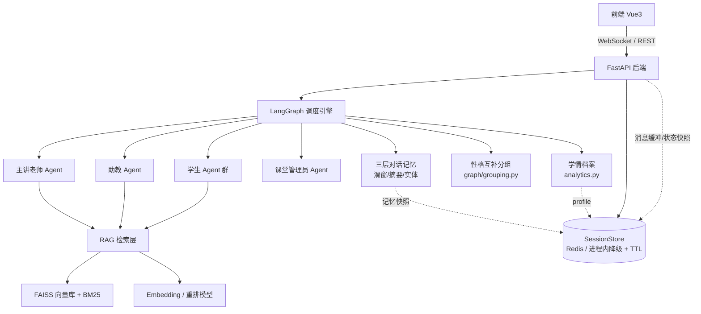
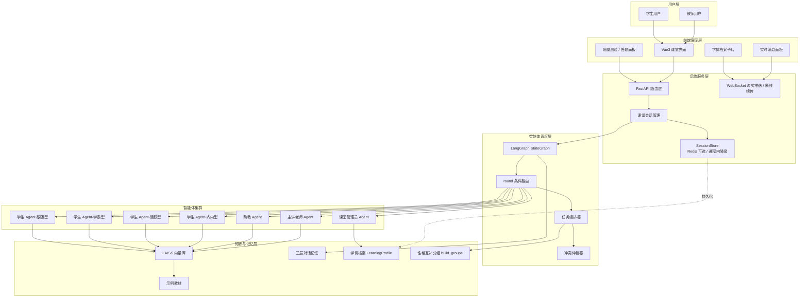
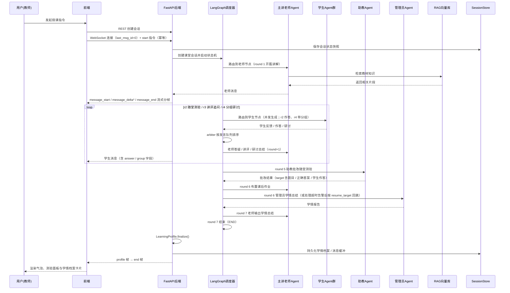
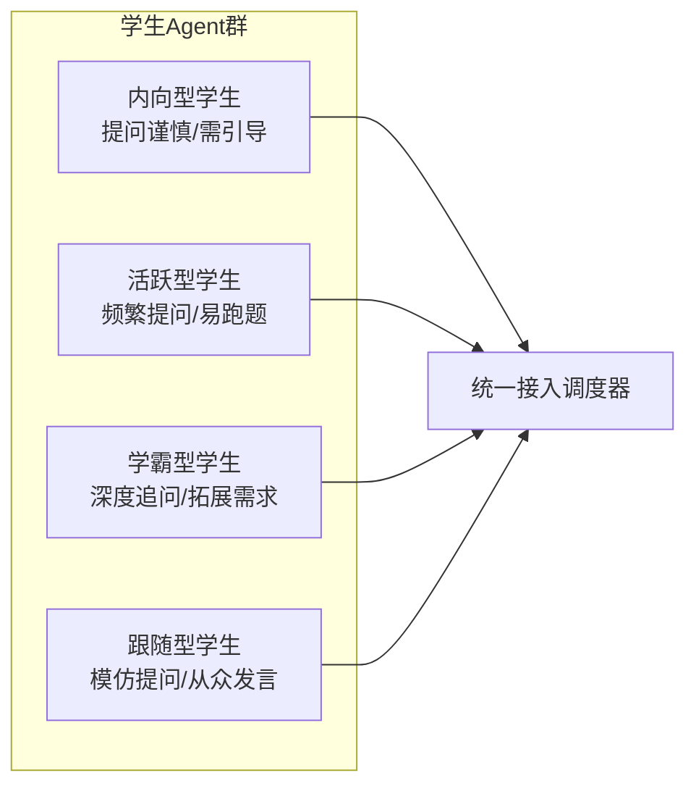
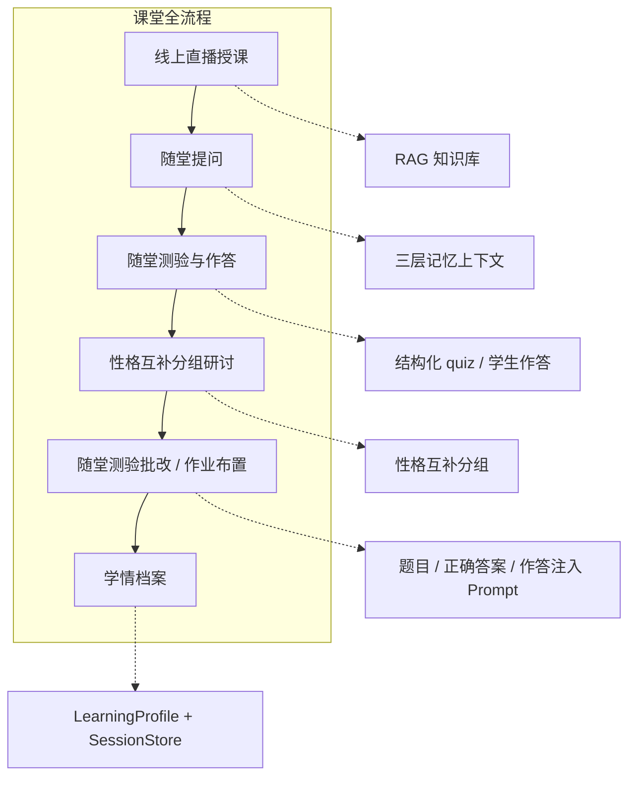
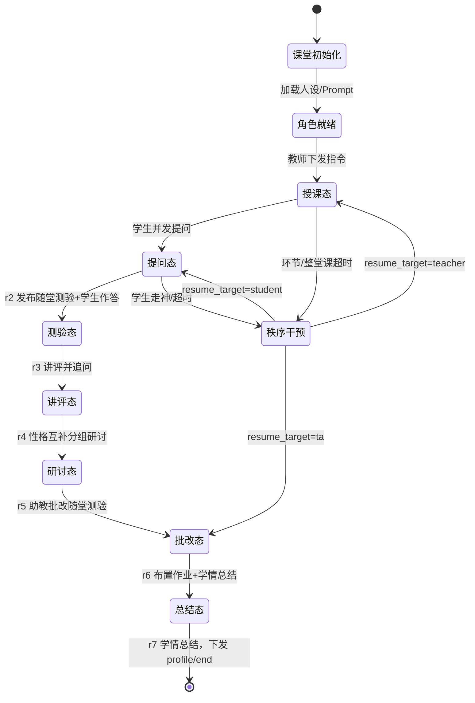
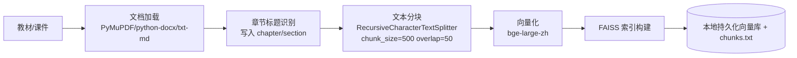
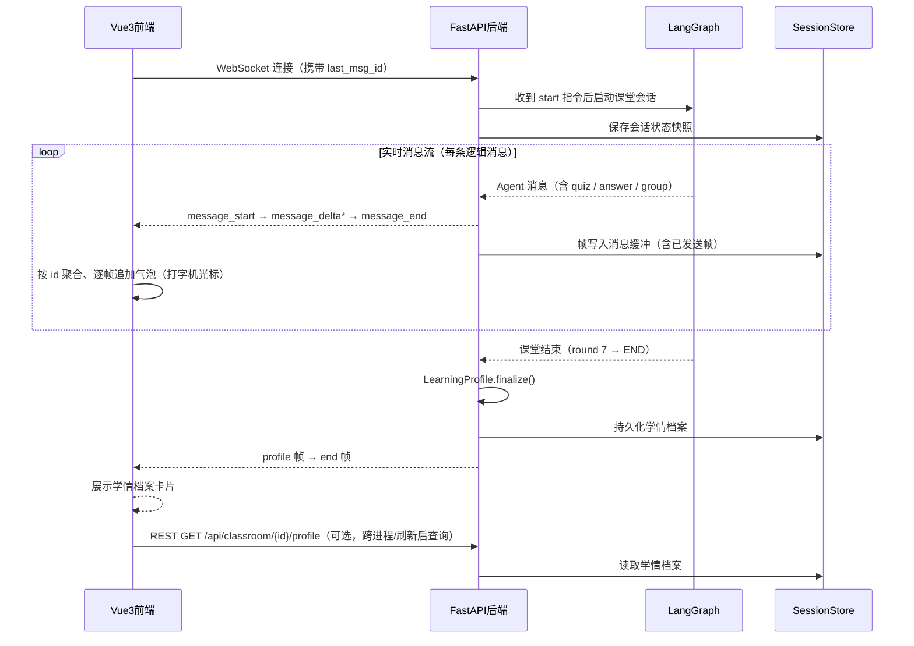
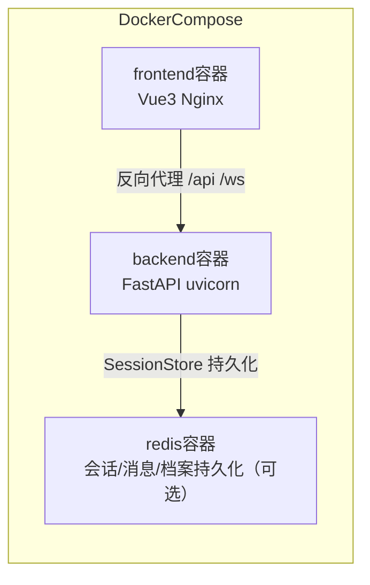

# AI Classroom 多智能体互动教学课堂

> 项目技术文档
> 版本：v1.1（P1 功能与数据对齐） ｜ 更新日期：2026-10-19

---

## 目录

1. [项目概述](#一项目概述)
2. [技术栈选型](#二技术栈选型)
3. [系统架构设计](#三系统架构设计)
4. [核心角色定义](#四核心角色定义)
5. [核心功能模块](#五核心功能模块)
6. [关键技术实现](#六关键技术实现)
7. [技术攻坚与踩坑实录](#七技术攻坚与踩坑实录)
8. [项目性能自测数据](#八项目性能自测数据)
9. [项目亮点](#九项目亮点)
10. [项目演进与优化方向](#十项目演进与优化方向)

---

## 一、项目概述

### 1.1 项目背景

当前在线教育场景中，AI 辅助教学多以"单 Agent + 知识库问答"模式为主，难以还原真实课堂中"师生互动、生生研讨、秩序管控"的多角色协同生态。传统方案存在以下痛点：

- **角色单一**：仅有一个 AI 助手，无法模拟真实课堂中老师、助教、学生等多角色协同；
- **上下文割裂**：缺乏跨轮对话记忆，学生提问无法关联前文知识点；
- **内容不可控**：LLM 凭空生成内容，存在"幻觉"风险，授课严谨性无法保障；
- **秩序缺失**：缺少课堂秩序管控（走神提醒、举手发言、超时限制），难以维持教学节奏。

### 1.2 项目目标

基于 **LangGraph 多智能体调度框架** + **RAG 向量检索** + **对话记忆机制**，搭建一套还原真实课堂全流程的 AI 多智能体互动教学系统，实现：

| 目标 | 说明 |
|------|------|
| 多角色协同 | AI 主讲老师、助教、多名性格差异化学生智能体、课堂管理员协同工作 |
| 全流程闭环 | 线上直播授课 → 随堂提问 → 随堂测验（出题 / 作答 / 讲评 / 批改）→ 性格互补分组研讨 → 作业布置 → 学情档案 |
| 内容可控 | 授课内容优先依托 RAG 知识库生成并标注引用，空检索时明确约束不编造教材引用 |
| 秩序管控 | 走神提醒、发言队列排序、单环节 / 整堂课超时限制，告警不吞教学轮次 |

### 1.3 项目价值

- **技术深度**：覆盖多智能体通信冲突、任务编排、角色边界管控等前沿难题；
- **场景稀缺**：市面极少多 Agent 课堂场景实现，具备差异化竞争力；
- **工程闭环**：从智能体调度到前端交互、Docker 云端部署的完整工程链路。

### 1.4 个人职责与代码实现

本人独立完成本项目的方案设计与编码实现（前端 Vue3 页面样式与静态资源除外），核心代码产出如下（行数按**非空行**统计）：

| 模块 | 文件 | 代码量 | 主要工作 |
|------|------|--------|----------|
| LangGraph 编排层 | `graph/workflow.py`、`graph/state.py` | workflow.py 432 行 | 定义 `ClassroomState` 状态字段与合并 reducer，编写 `route_by_phase` / `_route_target_for_round` 条件路由，编排 teacher / student / arbiter / ta / manager 5 类节点，实现 7 轮教学闭环、告警 `resume_target` 回跳与环节 / 整堂课超时检查 |
| 随堂测验与分组 | `graph/workflow.py`、`graph/grouping.py` | grouping.py 101 行 | r2 老师发布结构化 quiz、r2 学生并发作答、r3 讲评、r5 助教批改；r4 按性格互补调用 `build_groups` 分组并写入记忆 |
| 会话与流式推送 | `classroom.py` | 296 行 | 课堂会话生命周期、`message_start / delta / end` 流式分帧、学情档案 finalize 与 `profile` 帧下发、`_send_lock` 串行化、断线补发与发送异常兜底 |
| 学情档案 | `analytics.py` | 175 行 | `LearningProfile` 规则统计：学生发言 / 提问 / 答题 / 正确 / 超时 / 分组、课堂互动、测验正确率、知识点与薄弱点，`finalize()` 输出结构化档案 |
| 持久化存储 | `store.py` | 265 行 | `SessionStore`：Redis 持久化 + 进程内降级、TTL 与续期、`classroom:{session_id}:{meta\|profile\|messages}` key 约定、`purge_expired` |
| RAG 检索服务 | `rag/ingest.py`、`rag/retriever.py` | ingest.py 131 行、retriever.py 123 行 | 教材解析（txt / md / pdf / docx）与章节元数据、FAISS 索引构建、FAISS + BM25（jieba 分词）混合检索、可选 cross-encoder 重排与空检索兜底 |
| Agent 实现 | `agents/*.py` | teacher.py 107 行、student.py 138 行 | 四类角色 System Prompt（JSON 结构化输出约束）、老师 r2 出题、学生答题 / 分组研讨、助教批改、管理员告警收束与学情总结 |
| 三层对话记忆 | `memory/layered_memory.py` | 154 行 | 滑窗 + LLM 摘要压缩 + 实体关联（章节号 / 定理名抽取），`to_dict()` / `from_dict()` 快照序列化 |
| LLM 客户端 | `llm_client.py` | 181 行 | OpenAI 兼容客户端（DashScope，tenacity 指数退避）与内置 Mock LLM 双模式 |
| 前端 | `frontend/src` | 1538 行 | 课堂界面（流式气泡、打字机光标）、随堂测验面板、学情档案卡片、WS 封装与 `last_msg_id` 断线续传 |

后端 Python 共 **3254 行**（其中 `tests/` 718 行：`test_smoke.py` 290 + `test_store.py` 428），核心业务代码约 **2536 行**；前端 `src` 共 **1538 行**。P1 新增模块包括 `analytics.py`、`store.py`、`graph/grouping.py`，以及前端 `QuizPanel.vue`、`ProfileCard.vue`、`composables/useMessageStream.js`、`utils/format.js`；上述代码全部由本人编写与调试。

---

## 二、技术栈选型

### 2.1 整体技术栈

| 层级 | 技术选型 | 选型理由 |
|------|----------|----------|
| 智能体调度 | LangGraph | 原生支持 StateGraph 状态机，适合多 Agent 编排与条件路由 |
| LLM 接入 | 阿里百炼 Qwen（OpenAI 兼容 SDK）+ LangChain 组件 | LangChain 的 embedding / FAISS / BM25 组件便于检索层开发，LLM 统一走 OpenAI 兼容接口便于切换模型 |
| 向量检索 | FAISS | 开源、本地部署、上手简单，适合中小规模知识库（当前示例语料索引为 10 chunks） |
| 嵌入模型 | bge-large-zh（可选重排 bge-reranker-large） | 中文语义检索效果较好，可本地 CPU 部署（约 1.2GB）；重排模型（约 2.1GB）未缓存时自动跳过 |
| 后端框架 | FastAPI | 异步高性能，自带 OpenAPI 文档，便于前端对接 |
| 前端框架 | Vue3 + Vite + Element Plus | 组件丰富、开发效率高，对话气泡 / 测验面板 / 学情档案卡片可直接复用 |
| 实时通信 | WebSocket（消息级流式分帧） | 支持课堂直播式实时消息推送；`message_start / delta / end` 分帧配合前端打字机 |
| 持久化 | SessionStore：Redis（可选）+ 进程内降级 | 会话状态 / 消息缓冲 / 学情档案 / 记忆快照持久化，带 TTL；无 Redis 时单进程可用 |
| 测试 | 内置 Mock LLM + asyncio 回归脚本 | 无 Key / 索引 / Redis 也能跑完整课堂，覆盖 8 组冒烟用例与 11 项存储单测 |
| 容器化 | Docker + Docker Compose | 一键部署，环境隔离，便于交付（配置已编写，本机无 Docker 未实机验证） |

### 2.2 依赖关系图



---

## 三、系统架构设计

### 3.1 整体架构图



### 3.2 多智能体调度流程



---

## 四、核心角色定义

每个 Agent 拥有独立人设、权限边界、提示词约束，由 LangGraph 的节点函数承载。

### 4.1 角色权限矩阵

| 角色 | 人设定位 | 核心职责 | 权限边界 |
|------|----------|----------|----------|
| AI 主讲老师 | 严谨博学的学科专家 | 授课内容生成、知识点讲解、r2 随堂测验出题、r3 讲评与答疑 | 可调用 RAG 检索；不可批改（批改由助教完成）；不可管控秩序 |
| 助教 Agent | 耐心细致的辅导者 | 答疑解惑、r5 随堂测验批改（题目 / 正确答案 / 学生作答注入 Prompt） | 可检索知识库；不可发起授课；不可中断课堂 |
| 学生 Agent 群 | 性格差异化（内向 / 活跃 / 学霸 / 跟随），默认 4 人 | 模拟真实学生提问、追问、随堂测验作答、分组研讨 | 只能被动响应（由调度器按轮次唤起）；不可主动控场 |
| 课堂管理员 | 中立秩序维护者 | 处理走神 / 环节超时 / 整堂课超时告警并收束，输出学情总结 | 可中断非秩序发言；不可生成学科内容 |

### 4.2 学生智能体性格差异化设计



**性格差异化与互补分组设计**（`agents/student.py` + `graph/speaker_queue.py` + `graph/grouping.py`）：

| 性格 | 人设（System Prompt 约束） | 发言队列优先级 | 互补配对 |
|------|---------------------------|----------------|----------|
| `introvert` 内向型 | 提问谨慎、需要引导，较少主动发言，发言简短 | 1 | 与 `expert` 配对 |
| `active` 活跃型 | 频繁提问、积极参与，偶尔跑题、思路发散 | 2 | 与 `follower` 配对 |
| `expert` 学霸型 | 理解深入，擅长深度追问与拓展，发言条理清晰 | 3 | 与 `introvert` 配对 |
| `follower` 跟随型 | 倾向模仿其他同学提问，从众发言，内容简单 | 0 | 与 `active` 配对 |

- **差异化**：性格只影响人设 Prompt 与 `SpeakerQueue` 发言优先级，当前实现没有额外引入概率 / 延迟参数。
- **互补分组**：r4 研讨前由 `build_groups(students, STUDENT_GROUP_COUNT)` 按 `expert+introvert`、`active+follower` 配对，默认 2 组；组数不足时拆对补足，多出的配对单元 / 学生并入最后一组；讨论角度依次为「概念辨析」「例题应用」「拓展探究N」。

---

## 五、核心功能模块

### 5.1 功能全景



### 5.2 模块说明

#### 模块一：线上直播授课

- **触发方式**：教师通过 REST 创建会话，WebSocket 发送 `start` 指令（重复发送幂等）；
- **执行流程**：主讲老师 Agent 调用 RAG 检索教材片段 → 按当前轮次环节描述生成授课内容 → 以 `message_start / delta / end` 流式分帧实时推送；
- **秩序约束**：teacher 每轮检查 `STAGE_TIMEOUT_SECONDS`（默认 300s）/ `CLASS_TIMEOUT_SECONDS`（默认 1800s），超限产生告警并由管理员 Agent 收束。

#### 模块二：随堂提问与答疑

- **发起方**：r1 开篇讲解后，学生 Agent 群根据老师最新讲解并发生成提问；r3 讲评后学生继续追问；
- **响应方**：老师 r3 / r4 结合记忆上下文答疑收束；
- **记忆关联**：每轮对话写入 `LayeredMemory`（滑窗 + 摘要 + 实体），后续回答可关联前文知识点。

#### 模块三：随堂测验（出题 → 作答 → 讲评 → 批改）

- **出题（r2）**：主讲老师随消息发布结构化 `quiz`——`quiz_id`、`question`、恰好 4 个 `options`、`answer_index`（0-3）、`knowledge_point`，由 Pydantic 模型校验；
- **作答（r2）**：学生 Agent 群在 `asyncio.gather` 下逐个调用 `answer_quiz`，回传 `answer: {student_id, quiz_id, choice_index, choice_text}`，作答记录经 reducer 累积到 `quiz_answers`；
- **讲评（r3）**：老师节点把题目、正确答案与学生作答拼进环节描述，用于讲评；
- **批改（r5）**：助教 Agent 的 `target` 包含题目、选项、正确答案、知识点与每位学生的作答及对错，输出批改与讲评建议；
- **前端**：`QuizPanel` 展示题目、各选项人数与学生作答列表，有作答后标记正确选项；学生气泡显示「选 B」提示 chip；
- **数据落库**：作答记录与正确率进入学情档案 `quiz` 统计。

#### 模块四：小组研讨（性格互补分组）

- **分组策略**：`graph/grouping.py::build_groups` 按「expert + introvert」「active + follower」互补配对，默认 2 组（`STUDENT_GROUP_COUNT` 可配）；组数不足时拆对补足，多余学生并入最后一组；
- **讨论角度**：第 1 组「概念辨析」、第 2 组「例题应用」，更多组使用「拓展探究N」；
- **通信机制**：r4 学生 Agent 单轮并行研讨（节点内 `asyncio.gather`）→ 每条学生消息携带 `group` 字段（组名 / 角度 / 成员）→ 仲裁器按发言队列排序 → 老师总结研讨；
- **展示**：前端气泡展示「分组：第N组 · 讨论角度」徽章；学情档案按组统计发言数。

#### 模块五：随堂测验批改与作业布置

- **批改主体（r5）**：助教 Agent，批改对象是本堂课的随堂测验；
- **批改依据**：题目 / 选项 / 正确答案 / 知识点 + 学生作答明细注入 Prompt，可叠加 RAG 检索参考内容；
- **作业布置（r6）**：老师在学情总结前布置课后作业（仅布置，当前未实现作业提交与批改）；
- **反馈机制**：批改结果作为课堂消息推送。

#### 模块六：学情档案

- **数据来源**：课堂消息流（老师 / 学生 / 助教 / 管理员）+ 随堂测验作答 + 告警记录 + 分组记录；
- **生成方式**：`analytics.py::LearningProfile` 在课堂结束调用 `finalize()`，纯规则统计（非 LLM 生成）；
- **档案字段**：`topic / duration_seconds / rounds / messages / students[] / interaction / quiz / knowledge_points / weak_points / groups[]`（详见 6.7）；
- **输出**：课堂结束先通过 WS `profile` 帧下发，再推送 `end` 帧；同时持久化到 `SessionStore`，可通过 `GET /api/classroom/{session_id}/profile` 查询；前端 `ProfileCard` 展示。

---

## 六、关键技术实现

### 6.1 基于 LangGraph 的多智能体调度

#### 6.1.1 状态图设计



> 状态图简化了节点跳转细节，便于理解课堂整体流程。实际实现中（见 6.1.2 / 6.1.3），`提问态` / `测验态` / `研讨态` 都会路由到 `student` 节点并发生成，再由 `arbiter` 归并后回到 `teacher`，形成 `teacher → student → arbiter → teacher` 的闭环；课堂固定 7 轮，`round` 是路由唯一依据。

#### 6.1.2 核心调度逻辑实现

```python
from typing import TypedDict, Annotated
from langgraph.graph import StateGraph, END
import operator

# 课堂共享状态：messages / quiz_answers 用 operator.add 增量合并，避免覆盖历史
class ClassroomState(TypedDict):
    messages: Annotated[list, operator.add]  # 对话历史（追加式）
    new_messages: list                       # 学生节点本次新增、待仲裁器排序的消息（覆盖式）
    current_speaker: str                     # 当前发言角色
    phase: str                               # 课堂阶段（展示字段，不参与路由）
    topic: str                               # 授课主题
    memory: dict                             # 学生群 / 发言队列 / 分组 / 三层记忆
    order_alerts: Annotated[list, _merge_order_alerts]  # 秩序告警（追加 + 可清空）
    round: int                               # teacher 执行轮次（单调递增，路由唯一依据）
    # ---- P1 教学闭环新增字段 ----
    quiz: dict | None                        # r2 老师发布的随堂测验
    quiz_answers: Annotated[list, operator.add]  # 学生作答（追加式）
    stage_started_at: float                  # 当前教学环节开始时间
    class_started_at: float                  # 整堂课开始时间
    resume_target: str | None                # manager 处理完告警后回到的节点

# 构建状态图：每个节点对应一类 Agent
graph = StateGraph(ClassroomState)
graph.add_node("teacher", teacher_node)        # 授课 / 出题 / 答疑 / 讲评 / 总结
graph.add_node("student", student_group_node)  # 学生群节点
graph.add_node("ta", ta_node)                  # 随堂测验批改
graph.add_node("manager", manager_node)        # 告警收束 / 学情总结
graph.add_node("arbiter", arbiter_node)        # 仲裁器节点

# teacher 出边：告警优先去 manager，否则按 round 决定下一节点
graph.add_conditional_edges(
    "teacher",
    route_by_phase,
    {
        "teacher": "teacher",
        "student": "student",
        "ta": "ta",
        "manager": "manager",
        END: END,
    },
)
# 学生并发生成完后，由仲裁器归并排序
graph.add_edge("student", "arbiter")
# 仲裁器归并完，控制权交回老师继续授课
graph.add_edge("arbiter", "teacher")
# 助教批改完，交回老师
graph.add_edge("ta", "teacher")
# manager 出边：告警处理完按 resume_target 回到「本应去」的节点，不吞轮次
graph.add_conditional_edges(
    "manager",
    route_after_manager,
    {"teacher": "teacher", "student": "student", "ta": "ta", END: END},
)
graph.set_entry_point("teacher")
app = graph.compile()
```

> 状态机闭环：teacher（授课/提问/出题/讲评）→ student（并发生成）→ arbiter（归并）→ teacher（继续）→ ta（r5 批改）→ teacher → manager（告警收束或 r6 学情总结）→ teacher（r7 学情总结）→ END。仲裁器不直接接 student，否则会形成死循环；manager 用条件边按 `resume_target` 回跳，修复了「告警吞轮次」问题。

#### 6.1.3 条件路由函数实现

```python
def _route_target_for_round(round_val: int) -> str:
    """纯函数：仅按 round 决定「下一节点名」，不含告警分支（供 manager 计算 resume_target）"""
    if round_val <= 4:
        return "student"          # r1-r4：提问 / 测验作答 / 追问 / 分组研讨
    if round_val == 5:
        return "ta"               # 助教批改随堂测验
    if round_val == 6:
        return "manager"          # 学情总结
    return END                    # round >= 7 结束


def route_by_phase(state: ClassroomState) -> str:
    """根据课堂轮次（round）与告警路由下一节点（teacher 节点的出边）"""
    # 1. 秩序告警优先处理（manager 处理完会按 resume_target 回到原定节点）
    if state.get("order_alerts"):
        return "manager"

    phase = state.get("phase")
    round_val = state.get("round", 0) or 0

    if phase == "end":
        return END

    # 2. 以单调递增的 round 为唯一依据决定下一节点（不信任外部可能被篡改的 phase）
    if phase in ("teaching", "quiz", "answer", "discuss", "grading", "summary"):
        if round_val == 0:
            return "teacher"          # 开篇讲解
        return _route_target_for_round(round_val)

    return "manager"                  # 异常阶段由管理员兜底


def route_after_manager(state: ClassroomState) -> str:
    """manager 出边：告警处理完回到 resume_target 指定的节点（不能回到 manager 自身）"""
    target = state.get("resume_target") or "teacher"
    if target not in ("teacher", "student", "ta", END):
        target = "teacher"            # 防御：非法 / 自环目标一律回 teacher，避免死循环
    return target
```

**round 轮次与课堂环节对照表**（`round` 由 `teacher_node` 单调递增，路由只依赖 `round`；`phase` 由各节点在返回值里自行上报，消息气泡上的阶段标签与该条消息的实际环节一致）：

| round 值 | 路由目标 | 对应环节 | 老师消息 phase | 学生消息 phase |
|----------|----------|----------|----------------|----------------|
| 1 | student | 开篇讲解 → 学生随堂提问 | teaching | quiz |
| 2 | student | 答疑并发布随堂测验 → 学生作答 | answer | answer |
| 3 | student | 讲评随堂测验 → 学生追问 | answer | quiz |
| 4 | student | 答疑收束 + 性格互补分组研讨 | answer | discuss |
| 5 | ta | 研讨总结 → 助教批改随堂测验 | discuss | —（助教消息为 grading） |
| 6 | manager | 布置课后作业 → 管理员学情总结 | grading | —（管理员消息为 summary） |
| 7 | END | 老师输出学情总结后结束课堂 | summary | —（流程结束后先推 profile 再推 end 帧，phase=end） |

> `phase` 的职责：只用于前端展示与 `/api/classroom/{id}` 状态查询，不参与路由决策。teacher 按 `round` 查 `_ROUND_STAGE` 表得到阶段与环节描述，student/ta/manager 在返回值里上报自身阶段；课堂正常跑完后由 `ClassroomSession.run` 统一把 phase 置为 `end`，先推送 `profile` 帧再推送 `end` 帧（`phase == "end"` 在路由里只作为外部干预结束课堂的兜底判断）。

> **order_alerts 清空机制**：`order_alerts` 非空时路由会优先跳转 `manager`（秩序干预），`manager_node` 处理完告警后**必须清空 `order_alerts` 字段**，否则路由会因告警始终非空而反复跳转 manager，形成 `manager → teacher → manager` 死循环；同时 manager 在 return 中写入 `resume_target`，把控制权交回「本轮原定应去的节点」。

> **已修复：告警不再吞轮次**。旧实现中 manager 处理完告警固定回到 teacher、`round` 继续 +1，导致告警触发的课堂会跳过原本该执行的学生环节（`discuss` 轮也可能缺席）。现在 `manager_node` 用 `_route_target_for_round(round)` 计算被拦截的目标节点写入 `resume_target`，出边改为 `route_after_manager` 条件边：告警处理完回到原本应去的 `teacher / student / ta / END`，老师轮次始终为 7 轮。实测「全部学生超时」场景：alert 帧 16 条、manager 消息 5 条、teacher 消息仍为 7 条（round 1..7 连续）。

**为什么用条件边（conditional_edges）而非硬编码 if-else？**
阶段流转规则集中在路由函数中，新增阶段时只需扩展枚举与路由映射，无需改状态机构建代码；同时 LangGraph 支持把状态图导出为 Mermaid，便于调试阶段跳转。

> 关键设计：课堂阶段流转以单调递增的 `round` 计数（仅由 `teacher_node` 写入）作为唯一依据，而非 `phase` 字段。这样即使前端按钮或 Agent 提示词外部改写了 `phase`，也不会打乱 `teacher → student → ta → manager → end` 的固定顺序，避免「授课 ↔ 提问」来回跳导致的死循环。
>
> **关于 `phase` 字段的职责澄清**：`phase` 是给前端渲染和日志记录用的**展示字段**（前端根据 `phase` 切换"授课中/提问中/批改中"等界面态），由各节点在返回值中自行上报（teacher 按 `round` 查表、student/ta/manager 上报自身阶段），不参与路由决策。为防止 LLM 输出或前端按钮恶意篡改业务流，我把路由逻辑下沉到了底层的单调计数器 `round`。这是一个安全设计：固定流水线场景下 `round` 足够可靠；如果未来要支持动态插叙（如授课中临时插入随堂小测再回到授课），我会把 `round` 升级为阶段栈（Phase Stack），支持 push/pop 任意阶段，当前架构已预留这个扩展方向。

#### 6.1.4 多学生 Agent 并发处理与性格互补分组

小组研讨 / 随堂测验答题环节，多个学生 Agent 若串行调用 LLM 耗时会线性增长。采用 `asyncio.gather` 并行生成，并用 `asyncio.Semaphore(5)` 限制并发上限，仅在写入共享状态时由仲裁器串行化；单个学生 LLM 调用超时 30s 记入走神告警，不阻塞整体。

**学生群节点核心逻辑**（`graph/workflow.py::student_group_node`，节选）：

```python
import asyncio

_semaphore = asyncio.Semaphore(5)          # 控制并发上限，避免一次性打满 LLM 的 QPM
_STUDENT_LLM_TIMEOUT = 30.0                # 单个学生 LLM 调用超时（秒）

async def student_group_node(state: ClassroomState) -> dict:
    students = state["memory"]["students"]
    messages = state.get("messages") or []
    question = messages[-1]["content"] if messages else ""
    current_round = state.get("round", 0) or 0
    quiz = state.get("quiz")
    groups = state["memory"].get("groups") or []
    if current_round == 4 and not groups:
        groups = build_groups(students, config.STUDENT_GROUP_COUNT)  # 兜底：保证 r4 一定有分组

    group_by_student = {}
    for group in groups:
        for sid in group.get("member_ids") or []:
            group_by_student[sid] = group

    # r2 答题（phase=answer） / r4 分组研讨（phase=discuss） / 其余轮次提问与追问（phase=quiz）
    if current_round == 2:
        phase = "answer"
    elif current_round == 4:
        phase = "discuss"
    else:
        phase = "quiz"
    use_quiz = bool(current_round == 2 and quiz)

    # 发言队列每轮新建：按性格优先级排序，经 memory["queue"] 交给仲裁器（见 6.4.2/6.4.3）
    queue = SpeakerQueue()
    for s in students:
        queue.enqueue(s.student_id, s.personality)

    async def _respond_with_limit(student):
        group = group_by_student.get(student.student_id) if current_round == 4 else None
        async with _semaphore:
            if use_quiz:
                return await asyncio.wait_for(student.answer_quiz(quiz), timeout=_STUDENT_LLM_TIMEOUT)
            if group is not None:
                return await asyncio.wait_for(student.respond(question, group=group), timeout=_STUDENT_LLM_TIMEOUT)
            return await asyncio.wait_for(student.respond(question), timeout=_STUDENT_LLM_TIMEOUT)

    raw_responses = await asyncio.gather(
        *[_respond_with_limit(s) for s in students], return_exceptions=True
    )

    valid, alerts, answers = [], [], []
    for idx, resp in enumerate(raw_responses):
        student = students[idx]
        if isinstance(resp, Exception):
            alerts.append({"type": "timeout", "student": student.name})  # 走神告警
            continue
        msg = dict(resp)
        if current_round == 4:
            group = group_by_student.get(student.student_id)
            if group is not None:
                msg["group"] = group          # r4 每条学生消息都带分组
        elif use_quiz and msg.get("answer"):
            answers.append(msg["answer"])     # r2 作答经 reducer 累积进 quiz_answers
        valid.append(msg)

    update = {
        "new_messages": valid,
        "phase": phase,
        "memory": {**state["memory"], "groups": groups, "queue": queue},
    }
    if alerts:
        update["order_alerts"] = alerts
    if answers:
        update["quiz_answers"] = answers
    return update
```

**性格互补分组算法**（`graph/grouping.py::build_groups`）：

- 按性格分桶后按固定顺序配对：`expert + introvert`、`active + follower`，优先保证双人组性格互补，避免同质化扎堆；
- 目标组数取 `STUDENT_GROUP_COUNT`（默认 2），且不超过学生人数；组数不足时从最后一对开始拆对补足；
- 多出的学生 / 配对单元并入最后一组，保证不丢学生；
- 讨论角度依次为 `概念辨析`、`例题应用`，第 3 组起使用 `拓展探究N`；
- 输出结构：`{group_id, name, angle, member_ids, members}`，r4 由 teacher 节点写入 `memory["groups"]`，并通过 `_format_groups_brief` 拼进老师环节描述。

**r4 分组研讨 Prompt**（`agents/student.py::_GROUP_SECTION`，附加在学生 System Prompt 后）：

```text
【小组研讨】组名：{group_name}
讨论角度：{group_angle}
同组成员：{member_names}
请围绕该讨论角度，与同组成员协作完成研讨发言（可引用/补充同组同学观点）。
```

学生消息生成后会把 `group` 原样带回（供前端分组徽章与学情档案按组统计）。通过「节点内并发 + 仲裁器串行写入」两级处理，相比串行调用可以明显降低研讨环节的整体等待时间。

#### 6.1.5 Prompt 工程与防御性提示词

为了保证 Agent 输出可被代码解析（前端要按字段渲染对话气泡、引用来源），我在 System Prompt 中强制使用 JSON 结构化输出，并在代码侧用 Pydantic 做校验，格式错误时自动触发 LLM 重试修正。

**主讲老师 Prompt 示例**（`agents/teacher.py::_SYSTEM_PROMPT`，为节省篇幅省略了输出格式中的部分示例）：

```text
你是一位严谨的【主讲老师】。
【主题】{topic}
【当前环节】{stage_desc}
【参考内容】
{context}
【记忆上下文】
{memory_text}
约束：
1. 优先基于【参考内容】讲解，并标注引用来源（citation）；
2. 若【参考内容】为空，请基于该主题的通用知识展开讲解，citation 留空，不要编造具体教材章节引用；
3. 严禁输出任何未检索到的数学公式推导，严禁回答任何与课堂无关的闲聊。
输出格式必须严格遵循以下 JSON：
{
  "speaker": "teacher",
  "content": "授课正文...",
  "citation": ["教材第3章第2节"]
}
```

r2 出题环节会在老师 Prompt 末尾追加【随堂测验】约束（`_QUIZ_PROMPT_SECTION`），要求 `quiz` 与 `content` 一起输出：4 个选项、`answer_index` 为 0-3、`quiz_id` 形如 `quiz_1`，并输出 `knowledge_point`。对应 Pydantic 校验：`options` 必须恰好 4 个，`answer_index` 限定在 0-3，解析失败由上层重调 LLM / 兜底。

**Pydantic 校验 + 失败重调 LLM**（仅靠 Prompt 不够，LLM 偶尔会输出多余文本）：

> ⚠️ 关键逻辑：解析失败时**不能重试解析函数本身**——同一段错误文本重试解析结果必然还是失败。正确做法是捕获解析异常后，带着"请只输出纯 JSON"的修正 Prompt **重新调用一次 LLM**，再解析新结果。

```python
import re
from pydantic import BaseModel, Field, ValidationError

class QuizModel(BaseModel):
    """随堂测验结构（r2 由老师随消息一起发布）"""
    quiz_id: str
    question: str
    options: list[str]                      # 由 field_validator 校验必须恰好 4 个
    answer_index: int = Field(ge=0, le=3)   # 正确选项下标 0-3
    knowledge_point: str = ""

class TeacherMessage(BaseModel):
    speaker: str
    content: str
    citation: list[str] = Field(default_factory=list)
    action: str | None = None
    quiz: QuizModel | None = None           # 仅 r2 出题环节有值


def _try_parse(raw: str) -> TeacherMessage | None:
    """尝试从 LLM 原始输出中解析出 TeacherMessage。

    策略：
    1. 直接 model_validate_json（最快路径）；
    2. 失败则剥离 markdown 代码围栏后，用贪婪正则提取 {...} 块再解析
       （应对 LLM 加前缀/代码块包裹的情况；贪婪匹配容忍 JSON 内部嵌套花括号）；
    3. 都失败返回 None，由上层决定是否重调 LLM。
    """
    try:
        return TeacherMessage.model_validate_json(raw)
    except ValidationError:
        cleaned = re.sub(r"```json|```", "", raw)
        match = re.search(r"\{.*\}", cleaned, re.DOTALL)
        if match:
            try:
                return TeacherMessage.model_validate_json(match.group(0))
            except ValidationError:
                return None
        return None


async def generate_teacher_message(llm, prompt: str) -> TeacherMessage:
    """生成老师消息，格式错误时重调 LLM 而非重试解析。"""
    raw = await llm.ainvoke(prompt)
    msg = _try_parse(raw)
    if msg is not None:
        return msg

    # 解析失败：重调一次 LLM，追加强制格式约束
    retry_prompt = prompt + '\n\n【重要】上次返回格式错误，请只输出纯 JSON，不要带任何前缀、解释或 markdown 代码块。'
    raw2 = await llm.ainvoke(retry_prompt)
    msg2 = _try_parse(raw2)
    if msg2 is not None:
        return msg2

    # 仍失败：降级兜底，不让前端白屏
    return TeacherMessage(
        speaker="teacher",
        content="老师授课生成异常，请重试。",
        citation=[],
    )
```

> 实际代码在 `agents/base.py::BaseAgent.generate` 中统一实现上述「解析 → 失败重调 LLM → 兜底」流程：各角色通过 `output_model` 声明自己的消息模型（TeacherMessage / StudentMessage / TaMessage / ManagerMessage），无需重复实现重试逻辑。

**防御性提示词设计要点**：
- **防注入**：System Prompt 明确"严禁回答与课堂无关的闲聊"，避免学生 Agent 被诱导输出非课堂内容；
- **空检索兜底**：老师 Prompt 约束"优先基于参考内容讲解；参考内容为空时基于通用知识讲解、citation 留空，不要编造具体教材章节引用"，避免产出虚假引用；
- **格式约束**：JSON 结构化输出 + Pydantic 校验；解析失败重调一次 LLM 强制纯 JSON，仍失败则降级为兜底话术，不让前端白屏。

### 6.2 RAG 向量库接入

#### 6.2.1 知识库构建流程



知识库当前实际规模：`knowledge_base/` 仅 1 份示例教材《高等数学_极限与连续.txt》（42 行 / 7141 字节），按章节切分并向量化后为 **10 个 chunks**（索引保存在 `E:\ai_classroom_index`，同目录 `chunks.txt` 供 BM25 使用）。分块采用 `RecursiveCharacterTextSplitter`（chunk_size=500、overlap=50，按换行 / 句号 / 分号递归切分），解析时保留章节标题写入 metadata（`chapter` / `section`），保留知识点上下文完整性，避免一刀切导致的知识片段断裂。

#### 6.2.2 混合检索 + 重排序实现

纯向量检索在公式编号、专业术语等关键词匹配上效果一般，加入 BM25 关键词检索做融合，并用 cross-encoder 重排提升 top-k 准确率。

```python
from langchain_huggingface import HuggingFaceEmbeddings
from langchain_community.vectorstores import FAISS
from langchain_community.retrievers.bm25 import BM25Retriever

# 1. 向量检索器
embeddings = HuggingFaceEmbeddings(model_name="BAAI/bge-large-zh")
# allow_dangerous_deserialization：本地自建索引加载 pickle 文件，LangChain>=0.2 需显式开启
vectorstore = FAISS.load_local(
    VECTOR_INDEX_PATH, embeddings, allow_dangerous_deserialization=True
)
vector_retriever = vectorstore.as_retriever(search_kwargs={"k": 10})

# 2. BM25 关键词检索器（语料来自 ingest 阶段写入同目录的 chunks.txt）
#    关键：中文必须先分词再建索引，否则 BM25 会按单字拆分导致检索失真。
#    这里通过 preprocess_func 传入 jieba 分词，索引与查询都走同一套分词逻辑，
#    存储文档的 page_content 仍保留原始文本，不影响前端展示。
import jieba

def _jieba_tokenize(text: str) -> list[str]:
    return [tok.strip() for tok in jieba.cut(text) if tok.strip()]

with open(f"{VECTOR_INDEX_PATH}/chunks.txt", encoding="utf-8") as f:
    corpus = [line.strip() for line in f]
bm25_retriever = BM25Retriever.from_texts(corpus, preprocess_func=_jieba_tokenize)
bm25_retriever.k = 10

# 3. 手动融合：分别召回后按内容去重（langchain 1.x 已移除 EnsembleRetriever）
def rag_retrieve(query: str, top_k: int = 4):
    candidates, seen = [], set()
    for retriever in (vector_retriever, bm25_retriever):
        for doc in retriever.invoke(query):
            key = doc.page_content.strip()
            if key and key not in seen:
                seen.add(key)
                candidates.append(doc)

    # 4. cross-encoder 重排（模型未缓存时跳过，直接取前 top_k，避免约 2.1GB 模型下载阻塞授课）
    reranker = _get_reranker()
    if reranker is None:
        return candidates[:top_k]
    pairs = [[query, doc.page_content] for doc in candidates]
    scores = reranker.predict(pairs)
    ranked = sorted(zip(scores, candidates), key=lambda x: -x[0])
    return [doc for _, doc in ranked[:top_k]]
```

实际使用中，加入 BM25 与重排后对专业术语、公式编号类提问的召回有明显改善。

> **检索实测（本机 CPU）**：`bge-large-zh`（约 1.2GB）首次加载约 52s；首次检索约 8.3s（含 BM25 / jieba 建索引）；之后热检索 **203–241ms/次**。重排模型 `bge-reranker-large`（约 2.1GB）仅在已缓存时加载，未缓存时直接跳过（重排带来的精度提升与耗时未单独实测）。

> **中文分词细节**：BM25 是基于词频（Token）的算法，英文天然有空格分词，但中文必须依赖分词器。如果直接对中文句子跑 BM25，它只会按单个汉字去匹配，"微分方程"会被拆成"微""积""分""方""程"去匹配噪音，检索效果极差。因此在构建 BM25 索引前使用 `jieba` 进行中文分词（通过 `BM25Retriever.from_texts(corpus, preprocess_func=_jieba_tokenize)` 注入），确保关键词（如"微分方程""极限"）不会被截断。分词仅作用于 BM25 的索引与查询阶段，存储文档的 `page_content` 仍保留原始中文文本，不影响前端展示。

#### 6.2.3 RAG 生成链与防幻觉约束

```python
# 实际实现不再使用 RetrievalQAWithSourcesChain（langchain 1.x 已移除），
# 而是手动检索 + 拼装 Prompt：老师 Prompt 注入【参考内容】与【记忆上下文】，并要求标注 citation。
context = format_context(rag_retrieve(query, top_k=4))  # 把文档片段与章节号拼成参考内容
SYSTEM_PROMPT = """
你是一位严谨的【主讲老师】。
【参考内容】
{context}
【记忆上下文】
{memory_text}
约束：
1. 优先基于【参考内容】讲解，并标注引用来源（citation）；
2. 若【参考内容】为空，请基于该主题的通用知识展开讲解，citation 留空，不要编造具体教材章节引用；
3. 严禁输出任何未检索到的数学公式推导，严禁回答任何与课堂无关的闲聊。
"""
```

**防幻觉约束**：
- **强制检索**：老师 / 助教节点在生成前都会调用 `HybridRetriever.retrieve`（放到线程池执行，避免阻塞事件循环），检索结果拼进【参考内容】；
- **来源溯源**：`format_context` 会把文档的 `chapter` / `section` 拼在片段前，前端气泡展示 citation，便于核查；
- **空检索兜底**：索引缺失 / 加载失败时检索返回空列表，老师 Prompt 明确"基于通用知识讲解、citation 留空、不编造教材章节引用"，课堂流程不中断；
- **限制说明**：当前知识库仅 1 份示例教材（10 chunks），检索覆盖面有限，引用质量受语料规模约束。

---

### 6.3 对话记忆机制

#### 6.3.1 记忆分层设计

```mermaid
graph TD
    A[对话输入] --> B{记忆类型判断}
    B -->|短期| C[滑窗记忆<br/>最近若干轮原始对话]
    B -->|长期| D[摘要记忆<br/>超出窗口时压缩]
    B -->|实体| E[实体记忆<br/>知识点/学生关联]
    C & D & E --> F[综合上下文注入<br/>拼接到Agent System Prompt]
    F --> G[to_dict() 生成记忆快照]
    G -.写入 SessionStore.-> H[(classroom:session_id:memory)]
```

#### 6.3.2 实体记忆实现（关联前文知识点）

当学生提问"极限的定义是什么？"时，实体记忆会自动提取"极限"，并关联历史中提及该知识点的对话片段（例如几轮前老师讲过的定义与例题），保证回答不脱离前文语境。

```python
from memory.layered_memory import LayeredMemory

# 三层记忆：滑窗 + 摘要 + 实体（langchain 1.x 已移除 ConversationEntityMemory，
# 这里改为内置实体存储 + LLM 摘要调用的自定义实现，行为与原版一致）
memory = LayeredMemory(llm=llm, window_size=10, summary_threshold=20)

# 保存一轮对话：自动抽取知识点实体（章节号、定理名等）写入内置实体存储
memory.save_context(user_input, ai_output)

# 加载记忆变量：返回 {history, summary, entities}，注入 Agent System Prompt
memory_vars = memory.load_memory_variables({"input": user_input})
```

> 实体记忆的关键在于 `load_memory_variables`：根据当前输入中的实体名（如"极限"）从内置实体存储召回相关历史对话片段（返回的 `entities` 字段）。实体存储由正则抽取知识点实体自动维护，无需人工配置。

#### 6.3.3 摘要压缩（应对 token 窗口限制）

滑窗超过阈值时调用 LLM 摘要压缩历史，避免上下文无限膨胀超出 LLM token 限制。`LayeredMemory` 内置摘要压缩逻辑，在保留关键信息（已讲知识点、薄弱点）的前提下压缩前半段历史，并替换原始对话。

**实现思路**：
- **滑窗策略**：保留最近 N 轮原始对话（短期记忆）；
- **摘要压缩**：超过窗口阈值时，触发摘要器压缩前半段历史（长期记忆）；
- **实体提取**：抽取"知识点/学生姓名"等实体，建立实体关联，学生提问时可关联前文同一知识点。

> **记忆快照持久化**：`LayeredMemory` 提供 `to_dict()` / `from_dict()`，可把滑窗缓冲 `_buffer`、摘要文本 `_summary_text`、实体存储 `_SimpleEntityStore` 序列化为 JSON。会话层在每轮老师消息写入记忆后调用 `store.set_json("classroom:{session_id}:memory", memory.to_dict())`，配置 `REDIS_URL` 时写入 Redis，否则写入进程内存储；key 同样受 `CLASSROOM_TTL`（默认 3600s）约束。需要注意：当前课堂启动流程仍会新建记忆实例，`from_dict()` 的反序列化能力已具备但尚未接入自动恢复，跨进程/重启恢复仍是后续演进项。

---

### 6.4 课堂秩序管控

#### 6.4.1 秩序管控机制

| 机制 | 触发条件 | 执行动作 |
|------|----------|----------|
| 走神提醒 | 学生 Agent 单次 LLM 调用超过 30s | 记 `timeout` 告警，管理员 Agent 提醒收束 |
| 发言排序 | 学生并发回复返回顺序不确定 | `SpeakerQueue` 按性格优先级 + 先来先到排序，`arbiter` 串行写入 |
| 环节超时 | 单个教学环节耗时 > `STAGE_TIMEOUT_SECONDS`（默认 300s） | teacher 产生 `overtime` 告警，管理员收束后按 `resume_target` 回跳 |
| 整堂课超时 | 课堂总耗时 > `CLASS_TIMEOUT_SECONDS`（默认 1800s） | teacher 产生 `class_timeout` 告警，管理员收束 |
| 冲突仲裁 | 多 Agent 同时发言 | 学生消息经 `arbiter` + `asyncio.Lock` 串行排序；老师 / 助教节点由调度器串行执行，天然有序 |

三种告警字段（WS `alert` 帧中的 `alert` 对象）：

| type | 字段 | 触发场景 |
|------|------|----------|
| `timeout` | `{type, student}` | 学生 LLM 调用超时（30s） |
| `overtime` | `{type, stage, elapsed, limit, round}` | 单环节超过 `STAGE_TIMEOUT_SECONDS` |
| `class_timeout` | `{type, elapsed, limit}` | 整堂课超过 `CLASS_TIMEOUT_SECONDS` |

#### 6.4.2 发言队列实现（调度器内部排序）

```python
import heapq
import time

class SpeakerQueue:
    """发言队列：管理学生举手顺序"""
    PRIORITY_MAP = {"expert": 3, "active": 2, "introvert": 1, "follower": 0}

    def __init__(self):
        self._heap = []
        self._sequence = 0

    def __len__(self) -> int:
        # 支持 len(queue)，供仲裁器判断是否还有排队学生
        return len(self._heap)

    def enqueue(self, student_id: str, personality: str):
        # 学霸型学生可设更高优先级（差异化）
        p = self.PRIORITY_MAP.get(personality, 0)
        self._sequence += 1
        heapq.heappush(self._heap, (-p, int(time.time() * 1000), self._sequence, student_id))

    def next_speaker(self) -> str | None:
        if not self._heap:
            return None
        return heapq.heappop(self._heap)[3]
```

> 说明：`SpeakerQueue` 是调度器内部对学生发言的排序机制——并非真实学生自主举手；学生按轮次被动唤起，发言顺序由性格优先级 + 入队先后决定，队列每轮新建、无跨轮残留。

#### 6.4.3 冲突仲裁器节点

仲裁器作为 LangGraph 中间节点，**只对 student 节点本次新增的消息（`new_messages`）**按发言队列归并排序后，再追加进共享 `messages`，避免消息乱序。**切勿把全量历史取出来排序后返回**——否则经 `operator.add` 会把整段历史重复追加进 State。

```python
import asyncio

_write_lock = asyncio.Lock()

async def arbiter_node(state: ClassroomState) -> dict:
    """仲裁器：仅对本次新增消息按发言队列排序，串行写入共享状态"""
    pending = list(state.get("new_messages", []))
    # queue 由 student 节点每轮新建后写入 memory["queue"]，消费后自然清空，无跨轮残留
    queue: SpeakerQueue = state["memory"].get("queue", SpeakerQueue())

    async with _write_lock:
        ordered = []
        while queue and pending:
            spk = queue.next_speaker()
            # 消息的 speaker 字段统一为学生 id，与队列中的 student_id 保持一致，
            # 保证队列弹出的学生能精确匹配到本次新增消息
            match_msg = next((m for m in pending if m.get("speaker") == spk), None)
            if match_msg is None:
                # 队列中该学生本次没有新消息，保留其队列位置等待下次发言
                continue
            ordered.append(match_msg)
            pending.remove(match_msg)
        ordered.extend(pending)  # 未在队列中的消息按原序追加，不丢弃
        # messages 追加排序后的新增消息；new_messages 清空，避免下轮重复消费
        return {"messages": ordered, "new_messages": []}
```

### 6.5 前后端交互与部署

#### 6.5.1 前后端通信



#### 6.5.2 Docker 部署架构

> 说明：本机没有 Docker，以下部署配置未在本机验证，仅做了 YAML 语法与静态路径检查。



```yaml
# docker-compose.yml 核心结构
services:
  backend:
    build: ./backend
    ports: ["8000:8000"]
    environment:
      - REDIS_URL=redis://redis:6379
      - LLM_API_KEY=${LLM_API_KEY}    # 敏感信息走 .env
    depends_on: [redis]
  frontend:
    build: ./frontend
    ports: ["80:80"]
    depends_on: [backend]
  redis:
    image: redis:7-alpine
    ports: ["6379:6379"]
```

#### 6.5.3 服务稳定性与异常处理

线上跑课堂时遇到过 LLM 限流、WebSocket 断线等稳定性问题，做了如下容错处理：

**1. LLM 调用重试（指数退避）**：阿里百炼 Qwen 通过 OpenAI 兼容接口接入（`base_url` 指向 DashScope 兼容端点），因此后端可统一捕获 OpenAI SDK 的 `RateLimitError` / `APIConnectionError`；遇到限流或连接错误时按 2s/4s/8s 指数退避重试 3 次，避免单个 Agent 卡死阻塞整个课堂。

```python
import tenacity
from openai import RateLimitError, APIConnectionError

@tenacity.retry(
    stop=tenacity.stop_after_attempt(3),
    wait=tenacity.wait_exponential(multiplier=2, min=2, max=8),
    retry=tenacity.retry_if_exception_type((RateLimitError, APIConnectionError)),
)
async def llm_invoke(prompt: str) -> str:
    # LLM_TIMEOUT 由 config 读取（默认 60s，课堂 prompt 含 RAG 参考内容，生成耗时较长）
    return await asyncio.wait_for(llm.ainvoke(prompt), timeout=LLM_TIMEOUT)
```

**2. WebSocket 断线续传（先缓冲后发送 + last_msg_id 去重补发）**：实测发现连接刚断开时 ASGI 层的 `send` 可能不会立刻抛错，消息"看似发送成功"但客户端收不到。因此实现改为**每条帧先写入缓冲（SessionStore：配置 `REDIS_URL` 用 Redis，否则进程内实现，均带 TTL），再尝试推送**；前端重连时携带 `last_msg_id`，后端从缓冲中只补发 id 更大的帧。发送 / 补发统一捕获所有发送异常（断线时 Starlette 可能抛 `RuntimeError` / `WebSocketDisconnect` / `OSError`），失败只意味着帧留在缓冲里，不会中断课堂；单条发送加 5s 超时，避免半开连接把课堂卡死。

```python
async def send_or_buffer(session, payload: dict, msg_id: int):
    stored = {**payload, "id": msg_id}
    async with session._send_lock:                      # 与 replay 串行化，保证消息顺序
        await session.store.append_message(              # 先入缓冲（SessionStore）
            session.session_id, json.dumps(stored, ensure_ascii=False)
        )
        ws = session.ws
        if ws is None:
            return
        try:
            await asyncio.wait_for(ws.send_json(stored), timeout=SEND_TIMEOUT)
        except Exception:
            # 断线异常类型不可枚举（RuntimeError/WebSocketDisconnect/OSError），一律按发送失败处理
            if session.ws is ws:
                session.ws = None


async def replay_missed(session, ws: WebSocket, last_msg_id: int):
    # 显式传入当前连接：避免双连接并发补发时把消息错发到另一个连接
    async with session._send_lock:
        buffered = await session.store.list_messages(session.session_id)  # 缓冲整堂课保留、不裁剪
        try:
            for item in buffered:
                payload = json.loads(item)
                if payload.get("id", 0) > last_msg_id:
                    await asyncio.wait_for(ws.send_json(payload), timeout=SEND_TIMEOUT)
        except Exception:
            return  # 补发途中再次断线：帧仍在缓冲，下次重连按新的 last_msg_id 继续
```

> **并发串行化**：`send_or_buffer` 与 `replay_missed` 共用 `session._send_lock`。若不加锁，重连补发期间新产生的帧会直接 `send` 插到旧帧前面（实测顺序为 `1,4,2,3`），既造成前端气泡乱序，又会让客户端按 `last_msg_id` 去重时永久漏掉旧帧；加锁后顺序恒为 `1,2,3,4`。另外 WS 端点的 `start` 指令用 `session.started` 做幂等保护，重复发送不会让课堂状态机再跑一遍；会话不存在时先 `accept` 再 `close(4004)`，前端据此停止自动重连。

> **缓冲与 TTL**：发送成功的帧也留在缓冲里，重连只按 `last_msg_id` 过滤，因此无论客户端刷新、多客户端补历史还是补发途中断线，都不会因为"快照被删除"而永久丢消息。缓冲由 `SessionStore` 统一存储，默认 TTL 为 `CLASSROOM_TTL`（3600s），每次追加消息会刷新该会话 messages / meta / profile 三个 key 的过期时间；课堂运行期间持续续期，结束且超过 TTL 后自动过期（Redis 侧由 Redis 过期，进程内侧由 `purge_expired` / 惰性删除清理）。单堂课（Mock、4 学生、25 条消息）共 199 帧、缓冲约 30.8KB。

**3. RAG 检索降级**：检索器采用懒加载，索引缺失 / 模型不可用 / 加载异常时标记为不可用并返回空检索结果，课堂继续运行（老师基于通用知识讲解、citation 留空），不会因为 RAG 不可用导致服务崩溃；后端启动时另起后台线程预热 RAG（加载 embedding / FAISS / BM25 耗时较长），避免首个课堂请求阻塞事件循环。

```python
def _ensure_loaded(self):
    """首次检索前初始化；失败则标记不可用（空检索兜底），本次会话内不再重试"""
    if self._loaded or self._load_failed:
        return
    with self._load_lock:
        if self._loaded or self._load_failed:
            return
        try:
            self._load()          # 加载 embedding + FAISS + BM25 + 可选重排
            self._loaded = True
        except Exception:
            self._load_failed = True   # 索引缺失 / 模型未下载：返回空检索，不阻塞课堂
```

### 6.6 流式输出与打字机

P1 把「一条消息一个帧」改为「一条逻辑消息拆成多帧」，用于前端逐字渲染的打字机效果，同时保留断线续传不丢消息的能力。

#### 6.6.1 帧协议

每条逻辑消息拆成三类帧，**共用同一个自增 id**：

| 帧 | 字段 | 说明 |
|----|------|------|
| `message_start` | `id` + 消息元数据（`speaker`、`speaker_name`、`citation`、`quiz`、`answer`、`group`、`phase`、`round`） | 创建占位气泡 |
| `message_delta` | `id` + `delta` | 追加分片内容（默认 `STREAM_CHUNK_SIZE=12` 字/片） |
| `message_end` | `id` + 完整 `content` + 元数据 | 收尾并校准完整内容 |

- 所有帧都会先写入 `SessionStore` 消息缓冲，因此断线重连按 `last_msg_id` 补发时拿到的是完整的帧序列；
- 片间延迟由 `STREAM_INTERVAL_SECONDS`（默认 0.02s）控制，**仅在 WS 在线时**按节奏 sleep；离线时快速写入缓冲，重连补发不额外延迟；
- `STREAM_INTERVAL_SECONDS=0` 可关闭打字节奏（自动化测试即如此设置），此时只拆分帧、不等待。

#### 6.6.2 前端聚合与 lastMsgId 规则

`frontend/src/composables/useMessageStream.js` 按 `id` 聚合：`message_start` 建占位、`message_delta` 追加到同 id 气泡（绝不作为新消息）、`message_end` 用完整内容收尾；断线重连后若同一 id 的 `message_start` 再次到达，会先重置该气泡内容再重新累积分片，保证不重影、不缺字。

`lastMsgId` 的推进规则是断线续传正确性的关键：

- **推进**：`message_end` / `alert` / `end` / `error` / 旧协议 `message` 帧；
- **不推进**：`message_start` / `message_delta` / `profile`。

这样当一条流式消息只收到部分 `message_delta` 时断线，`lastMsgId` 仍停在上一条已完成消息，重连后服务端会从该消息的 `message_start` 起重发完整序列，前端按 id 重置后重新打字，不会出现半条消息永久缺失。

#### 6.6.3 性能开销与边界

- 帧数放大：Mock 全流程（4 学生、25 条逻辑消息）共产生 **199 帧**，消息缓冲约 **30.8KB/堂**；
- 真实 API + RAG 全链路（P1 冒烟）：单堂共 **616 个 WS 帧**（真实模型消息内容远长于 Mock，分片数随之增加），耗时约 162.5s，详见第八章；
- 耗时对比：同一 Mock 流程关闭打字节奏 **4.07s**，保持 0.02s / 12 字节奏 **10.19s**（耗时主要来自分片 sleep）；
- 属**消息级分片**：LLM 仍是整条生成后由后端切片推送，不是 token 级流式；真正的 token 级流式列为演进方向（见 10.1）。

### 6.7 学情档案与持久化

#### 6.7.1 LearningProfile 统计口径

学情档案由 `backend/analytics.py::LearningProfile` 在课堂运行期间增量收集、结束后 `finalize()` 生成，**纯规则统计、不调用 LLM**，避免报告内容不可控。统计口径：

- **消息**：每推送一条老师 / 学生 / 助教 / 管理员消息调用 `record_message`，统计总消息数、各角色消息数；学生「提问数」按内容是否包含 `？` / `?` 统计；
- **测验**：`record_quiz` 记录 r2 题目；`record_answers` 记录学生作答；`finalize` 按 `answer_index` 与 `choice_index` 计算作答人数与正确率；
- **告警**：`record_alert` 统计告警数，`type=timeout` 时给对应学生累加超时（走神）次数；
- **分组**：从 r4 学生消息的 `group` 字段归集组名 / 讨论角度 / 成员，并累计每组发言数；
- **知识点**：从消息 `citation` 与测验 `knowledge_point` 去重收集；
- **薄弱点**：测验存在答错时记入该题知识点，存在学生超时时追加「课堂参与度（存在超时/走神）」。

#### 6.7.2 档案结构

```json
{
  "topic": "高等数学 第一章 极限与连续",
  "duration_seconds": 12.4,
  "rounds": 7,
  "messages": 25,
  "students": [
    {"id": "student_1", "name": "同学1", "personality": "introvert",
     "group": "第1组", "messages": 4, "questions": 2, "answers": 1,
     "correct": 1, "timeouts": 0}
  ],
  "interaction": {"student_messages": 16, "teacher_messages": 7, "ta_messages": 1,
                  "manager_messages": 1, "alerts": 0, "student_ratio": 0.64},
  "quiz": {"question": "...", "options": ["...", "...", "...", "..."],
           "total_answered": 4, "accuracy": 1.0},
  "knowledge_points": ["教材第2章 极限与连续"],
  "weak_points": [],
  "groups": [{"group_id": "group_1", "name": "第1组", "angle": "概念辨析",
              "members": ["同学1", "同学3"], "messages": 2}]
}
```

> 上例字段结构来自 Mock 实测档案（数值仅为示意）；`accuracy` 为 0-1 小数，无作答时为 `null`。P1 真实 API + RAG 全链路冒烟中，r2 结构化测验解析 1/1 成功（4 选项、`answer_index=1`、知识点齐全），4 名学生作答全部正确（accuracy=1.0）——单次样本，非统计口径。

#### 6.7.3 存储与出口

- **WS 出口**：课堂结束先推 `{"type": "profile", "profile": {...}}`，再推 `{"type": "end"}`；前端收到 `profile` 后渲染 `ProfileCard`；
- **REST 出口**：`GET /api/classroom/{session_id}/profile`，优先取本进程会话的档案，其次从 `SessionStore` 读取；未生成 / 会话不存在返回 404；
- **持久化**：`SessionStore.save_profile` 写入 `classroom:{session_id}:profile`（Redis 或进程内），TTL 默认 `CLASSROOM_TTL=3600s`；
- **跨进程查询**：`GET /api/classroom/{session_id}` 与 `/profile` 在本进程找不到会话时会回落到 `SessionStore` 的状态快照 / 档案，因此在配置 Redis 的前提下可从其他进程查询；未配置 Redis 时仅单进程有效。

---

## 七、技术攻坚与踩坑实录

本章记录项目开发过程中实际遇到的 Bug 与解决过程，体现真实的工程调试能力。

### 7.1 踩坑一：多 Agent 并发写入导致消息丢失

- **现象（Bug）**：小组研讨环节，多个学生 Agent 并行调用 LLM 后返回的消息出现顺序错乱、部分学生回复直接丢失。日志里没有报错，但消息数量对不上。
- **排查过程**：打断点发现 LangGraph 的 State 对 `messages` 字段默认是**覆盖式写入**（后写的直接覆盖前面的），不是追加。最初实现是"学生群节点并行调用 LLM 后，把每个学生的回复各自作为 `{"messages": [单条消息]}` 返回"，LangGraph 按返回顺序逐条应用写入，最后写入的覆盖了前面的；且并行返回的顺序不可控，导致消息错乱丢失。
- **我的解法**：
  1. 把 State 的 `messages` 字段改为 `Annotated[list, operator.add]`，让 LangGraph 自动做追加合并而不是覆盖；
  2. 但追加合并后顺序是 LLM 完成顺序（不确定），于是学生群节点改为**只产出本次新增消息（`new_messages`）**，由 `arbiter` 仲裁节点用 `asyncio.Lock` 串行化写入，按 `SpeakerQueue` 优先级 + 时间戳排序后再追加进 `messages`；
  3. 单个 Agent 超时（`asyncio.wait_for` 30s）不阻塞队列，记入 `order_alerts` 作为走神提醒。
- **结果**：消息不再丢失，顺序严格按发言队列排序。

### 7.2 踩坑二：RAG 检索返回前言/目录，正文丢失

- **现象（Bug）**：提问"微积分基本定理"，检索返回的 chunks 全是前言和目录页，正文定义根本没召回。
- **排查过程**：用 `RecursiveCharacterTextSplitter` 默认按 `\n\n` 切分，PDF 转 txt 时章节层级丢失，"第3章 微积分基本定理"这种标题和正文混在一起被切成碎片，向量检索时前言的高频词（"微积分""定理"）反而得分更高。
- **我的解法**：
  1. 改用 PyMuPDF 提取 PDF 时保留章节标题作为 `metadata`（`{"chapter": "第3章", "section": "3.2"}`）；
  2. 分块时用 `RecursiveCharacterTextSplitter` 配合自定义分隔符（章节标题、换行符递归切分），保证一个知识点不被跨 chunk 切断；
  3. 检索结果保留章节 metadata，并在参考内容里拼上章节号（`format_context`），便于溯源与前端展示；按章节过滤检索尚未实现（列为后续演进方向）；
  4. 加入 BM25 关键词检索做混合，互补向量检索在"定理""公式"等专有名词上的盲区。
- **结果**：正文定义类提问的召回明显改善，不再返回前言/目录碎片。

### 7.3 踩坑三：LLM 输出格式不合法导致前端渲染崩溃

- **现象（Bug）**：前端 `JSON.parse(teacher_msg)` 偶发抛 `SyntaxError: Unexpected token`，导致整个对话面板白屏。查后端日志发现 LLM 返回的不是纯 JSON，前面带了"好的，以下是授课内容："这种前缀文本。
- **排查过程**：System Prompt 里写了"输出 JSON"，但 LLM（尤其 Qwen 等国产模型）有时会"礼貌性"加一句开场白再给 JSON，直接 `JSON.parse` 就崩了。
- **我的解法**：
  1. 用 Pydantic 定义 `TeacherMessage` 模型做结构校验；
  2. 解析失败时先用正则提取 `{...}` 部分再解析一次（应对 LLM 加前缀文本）；
  3. **仍失败则重新调用 LLM**（而非重试解析函数——同一段错误文本重试解析必然还是失败），重调时在 Prompt 末尾追加"上次返回格式错误，请只输出纯 JSON，不要带任何前缀或代码块"；
  4. 仍失败则降级为兜底话术"老师授课生成异常，请重试"，不让前端白屏。
- **结果**：前端不再因格式问题崩溃；格式错误率未做系统统计（旧文档中的比例已删除），当前策略是「解析失败重调一次 LLM + 兜底话术」保证不白屏。

### 7.4 踩坑四：WebSocket 长连接频繁断开

- **现象（Bug）**：课堂跑 2-3 分钟后 WebSocket 自动断开，前端收到 `onclose` 但没有重连逻辑，学生中途掉线后错过后续授课。
- **排查过程**：部署架构里 Nginx 反代的 `proxy_read_timeout` 默认 60s，课堂在老师讲授长段落时前端只接收不发，被判定为空闲连接切断；本地直连 uvicorn 开发时不会触发该问题，需在容器/Nginx 环境下复现。
- **我的解法**：
  1. 前端加心跳，每 30s 发一次 `{"type":"ping"}`，后端回 `pong` 保活；
  2. `onclose` 时指数退避重连（1/2/4/8s，最多重试 5 次），重连时携带 `last_msg_id`，后端从消息缓冲（配置 `REDIS_URL` 用 Redis，否则进程内）补发断线期间的消息；
  3. 后端改为「先入缓冲、再尝试发送」：连接刚断时 `send` 可能不报错（消息看似已发但客户端收不到），先缓冲可避免丢消息；重连按 `last_msg_id` 去重补发，补发中途再次断线则保留缓冲等下次重连继续。
- **结果**：长连接稳定，断线后能续传，不再错过中途消息；实测断线期间产生的消息在重连后按 id 连续补发、不丢最后一条 `end` 事件。

### 7.5 踩坑五：LLM 限流导致课堂卡死

- **现象（Bug）**：研讨环节学生 Agent 群（默认 4 人，可配置）同时调用 LLM，触发 `RateLimitError: Too many requests`，整个课堂卡住无法继续。
- **排查过程**：单个 LLM 账号有 QPM 限制，并发请求堆叠直接撞限流，没有重试机制时整个 `asyncio.gather` 抛错退出。
- **我的解法**：
  1. 给 LLM 调用包一层 `tenacity` 重试装饰器，遇到 `RateLimitError` / `APIConnectionError` / `TimeoutError` 按 2s/4s/8s 指数退避重试 3 次；
  2. 用 `asyncio.Semaphore` 控制并发上限（默认 5），避免一次性打满 QPM；
  3. 单个学生 LLM 调用超时（30s）跳过并标记走神，不阻塞整体队列。
- **结果**：限流时自动退避重试，课堂不再卡死。

### 7.6 踩坑六：流式分帧与断线续传的 id 设计

- **现象（Bug）**：最初实现「一条消息一个帧」推送，前端只能整条渲染，无法做打字机；改成流式分帧后又出现「重连后半条消息缺字/重影」。
- **排查过程**：一条逻辑消息拆成 `start / delta / end` 后，一开始把 `lastMsgId` 在 `message_delta` 帧上也推进；当一条消息只收到部分 delta 时断线，前端记录的 `lastMsgId` 已前进到该消息 id，重连时服务端认为「该 id 已收到」不再补发，这条消息就永远只有半条。另外重连补发时同 id 的 `message_start` 再次到达，如果前端直接新建气泡会出现重影。
- **我的解法**：
  1. `message_start / message_delta / message_end` 共用同一个自增 id，前端按 id 聚合成一条气泡；
  2. `lastMsgId` 只在 `message_end / alert / end / error / 旧 message` 这类「完整 / 终结」帧上推进，`message_start / message_delta / profile` 不推进；
  3. 前端收到同 id 的 `message_start` 时先重置该气泡内容、再重新累积 delta；
  4. 附带收益：一条消息的分片只占一个 id，缓冲按 id 过滤补发时天然按消息粒度完整重发。
- **结果**：断线重连后消息按 id 连续补发，半条消息从 `message_start` 完整重发、不重影；`test_smoke.py` 的断线续传用例覆盖「不丢尾消息、补发失败可重试」。

### 7.7 踩坑七：Code Review 发现的补发乱序与串台

- **背景**：P0 完成后做 Code Review，针对「多客户端 + 重连补发 + 实时推送」并发场景补充了回放测试，发现三个问题。
- **现象 1（补发与实时推送并发乱序）**：重连补发进行中，新一轮课堂消息实时推送到同一连接，实测客户端收到 id 顺序为 `1,4,2,3`——新消息插到了补发消息中间。
- **解法 1**：给会话加一把 `asyncio.Lock`（`session._send_lock`），`send_or_buffer` 与 `replay_missed` 全程持锁；补发期间新帧排队等待，顺序恒为 `1,2,3,4`。
- **现象 2（补发串台）**：`replay_missed` 最初直接用 `session.ws` 发送，而 `session.ws` 会被新连接覆盖；两个连接并发补发 / 新连接建立时，消息被发到了另一个连接，两端都可能缺消息。
- **解法 2**：`replay_missed` 改为显式接收「当前连接 ws」参数，补发只写给本次连接；发送失败也只清空匹配的连接引用（`if session.ws is ws`），不会误清后建立的新连接。
- **现象 3（发送异常类型不可枚举）**：断线时 Starlette 底层可能抛 `RuntimeError` / `WebSocketDisconnect` / `OSError` 等，最初只捕获 `WebSocketDisconnect`，其他异常会让课堂任务中断。
- **解法 3**：统一 `except Exception` + 每条帧 5s 超时；发送失败只标记连接失效，帧保留在缓冲，课堂不中断。
- **回归保障**：`test_smoke.py` 中「补发只发给当前连接」「补发与实时推送串行化」「发送异常不中止课堂」三组用例覆盖上述问题。

---

## 八、项目性能自测数据

以下数据为本地单机实测结果（测试机：Intel i7-6700HQ / 11.8GB RAM / 无 GPU / Windows；Python 3.13（`.venv`）；Node 24），仅作为开发阶段自测参考，非生产级压测；未实测项均明确标注，不做估算填充。

| 指标 | 测试场景 | 实测数据 |
|------|----------|----------|
| 知识库规模 | `knowledge_base/` 示例教材 + FAISS 索引 | 1 份 txt（42 行 / 7141 字节）→ 10 chunks |
| Mock 全流程耗时（无打字节奏） | 4 学生 / 25 条消息，`STREAM_INTERVAL_SECONDS=0` | 4.07s |
| Mock 全流程耗时（打字节奏） | 同上，`STREAM_INTERVAL_SECONDS=0.02`、`STREAM_CHUNK_SIZE=12` | 10.19s |
| 流式帧数与缓冲 | 单堂课（4 学生 / 25 条消息） | 199 帧/堂；消息缓冲约 30.8KB/堂 |
| 真实 LLM 全流程（P0） | 阿里百炼 `qwen-plus`，4 学生、关闭 RAG | 25 次 LLM 调用，总耗时约 69s（P0 阶段实测） |
| 真实 API + RAG 全链路（P1 冒烟） | 阿里百炼 `qwen-plus`，RAG 开启（`E:\ai_classroom_index` 本地索引 + `bge-large-zh`，跳过重排模型），`STREAM_INTERVAL_SECONDS=0`（关闭打字节奏，纯测链路），4 学生 | 约 162.5s / 25 次 LLM 调用 / 616 个 WS 帧；老师 7 轮 phase 序列正确、r2 结构化测验解析成功（4 选项、`answer_index=1`、知识点齐全）、4 名学生作答全部正确（accuracy=1.0）、2 个互补分组（第1组 概念辨析 同学1/同学3；第2组 例题应用 同学2/同学4）、学情档案完整；RAG 引用命中教材章节（第1章 1.2/1.5、第2章 2.1/2.3 等）；单次全链路冒烟实测，未做系统压测 |
| RAG 模型加载 | `bge-large-zh`（约 1.2GB）CPU 首次加载 | 约 52s |
| RAG 首次检索 | 含 BM25 / jieba 建索引 | 约 8.3s |
| RAG 热检索 | 索引与模型已加载 | 203–241ms/次 |
| 重排模型 | `bge-reranker-large`（约 2.1GB） | 已缓存时加载，未缓存自动跳过（加载耗时未单独实测） |
| 前端构建 | `npm run build` | 约 11s，1602 modules；产物 JS 1047KB（gzip 344KB）/ CSS 368KB（gzip 50KB）；Vite 有既有的 chunk>500KB 警告 |
| 自动化测试 | `test_smoke.py` 8 组 + `test_store.py` 11 项 | 全部通过（Mock，无需 Key / 索引 / Redis） |

**测试方法**：

- Mock / 真实 LLM 全流程耗时：用 `time.perf_counter()` 包住 `ClassroomSession.run()` 全程，取多次运行的代表值；Mock 模式通过 `llm_client.LLM_API_KEY=""` 强制走内置 Mock LLM；
- 流式帧数与缓冲大小：课堂结束后遍历 `SessionStore.list_messages()` 统计帧数、累加 UTF-8 字节数；测耗时默认关闭打字节奏（`STREAM_INTERVAL_SECONDS=0`），再单独用默认 0.02s/12 字节奏测一次；
- RAG 延迟：在 `HybridRetriever.retrieve` 外层用 `time.perf_counter()` 打点，区分「首次检索（含模型加载 / BM25 建索引）」与「热检索」；
- P1 全链路实测：真实 `qwen-plus` + 本地 FAISS 索引（RAG 开启、跳过重排模型），设置 `STREAM_INTERVAL_SECONDS=0` 跑完整课堂，记录总耗时、LLM 调用次数、WS 帧数、老师 7 轮 phase、r2 测验解析与学生作答正确率、分组 / 学情档案及 RAG 引用章节；RAG embedding 为后台预热与课堂并发加载。单次样本，非统计口径；
- 前端构建：`npm run build` 计时并读取 Vite 输出的 modules 数与产物体积；
- 内存峰值：P1 版本未重新采样（`psutil` 相关脚本未纳入回归），本表不再给出内存峰值数字。

**关于学生 Agent 并发耗时的说明**：

当前默认 4 个学生 Agent，`asyncio.gather` 并发 + `Semaphore(5)` 限流；Mock 模式下单次 LLM 调用固定延迟 0.3s，因此 Mock 全流程耗时的差异主要来自流式分片节奏（4.07s → 10.19s）。真实 API 下单次 LLM 请求约 2–3s（P0 阶段观察，未做系统压测）；P1 真实 API + RAG 全链路单堂实测约 162.5s（25 次调用，含 RAG 检索与课堂串行调度），同样未做系统压测，不能简单用「162.5s ÷ 25」推算单请求耗时。学生数可通过 `STUDENT_PERSONALITIES` 调整，但并发规模受 LLM QPM 限制，扩大规模时需要同步调整 `Semaphore` 上限或改用多 Key / 本地模型。当前未实现按角色限制 `max_tokens`，也未实现 token 级流式（见 10.1）。

---

## 九、项目亮点

| 亮点 | 说明 |
|------|------|
| 多智能体状态机编排 | LangGraph 5 类节点 + `round` 单调路由 + manager `resume_target` 回跳，课堂固定 7 轮、告警不吞轮次 |
| RAG 防幻觉机制 | FAISS + BM25 混合检索、章节引用溯源、空检索时约束不编造教材引用 |
| 性格互补分组研讨 | expert+introvert、active+follower 互补配对，r4 并发研讨并携带分组字段，学情档案按组统计 |
| 随堂测验闭环 | r2 老师出结构化 quiz → 学生作答 → r3 讲评 → r5 助教批改 → 学情档案正确率统计，前端 QuizPanel 实时展示 |
| 消息级流式 + 打字机 | `message_start / delta / end` 同 id 分帧、前端按 id 聚合逐帧渲染，断线重连半条消息从 start 重发不重影 |
| 学情档案 | 纯规则统计的 `LearningProfile`，WS `profile` 帧 + REST `/profile` 双出口，持久化到 SessionStore |
| 存储降级 + TTL | SessionStore 统一 Redis / 进程内存储，连接失败自动降级并告警，会话 / 缓冲 / 档案共享 TTL 与续期策略 |
| 回归测试 | Mock LLM 下 8 组冒烟（流式 / 测验 / 分组 / 续传 / 幂等 / 告警路由 / 超时）+ 11 项存储单测，无需 Key / 索引 / Redis |
| 工程容错闭环 | LLM 指数退避重试、Pydantic 校验失败重调、发送异常兜底、4004 会话失效处理、重复 start 幂等 |
| 本地一键启动 | Docker Compose 配置与知识库索引脚本（配置已编写，本机无 Docker 未实机验证） |

---

## 十、项目演进与优化方向

### 10.1 后续演进方向

| 方向 | 演进内容 |
|------|----------|
| token 级流式 | 当前为消息级分片 + 前端打字机；后续接入 LLM `stream=True`，把帧协议改造为 token 级流式 |
| 多模态扩展 | 接入语音直播（TTS/ASR），支持板书图片识别 |
| 学情个性化 | 基于学情档案为真实学生生成个性化学习路径，并接入真实学生作答 |
| Agent 动态扩容 | 当前学生数可通过 `STUDENT_PERSONALITIES` 配置，后续支持大班课堂的并发调度与 QPM 配额管理 |
| 评估体系 | 引入课堂质量评估指标（互动率、知识点覆盖率）与 RAG 离线评测（Hit Rate / MRR） |
| 知识库增量 | 支持教师实时上传课件、增量更新向量库，并扩充示例语料规模 |
| 向量库升级 | 从 FAISS 迁移到 Milvus，支持更大规模与 GPU 索引 |
| 鉴权与多班级 | 增加登录鉴权、多班级 / 权限体系，支持多课堂并发 |
| Docker 实机验证与 CI | 在真实 Docker 环境验证 compose 部署，并把回归脚本接入 CI |
| 可观测性 | 接入 LangSmith 做链路追踪，定位多 Agent 交互中的延迟瓶颈 |
| 安全合规 | 接入内容审核，防止不当言论输出 |

### 10.2 技术成长反思（如果给我更多时间重构）

- **Prompt 与代码解耦**：当前 Agent Prompt 直接写在 `agents/*.py` 里（开发初期为快速验证可行性，耦合在一起迭代更快）。后续计划把 Prompt 模板抽离为独立 `yaml` 配置文件，实现热更新，无需重启即可调整授课风格。
- **向量库升级**：当前 FAISS 只承载示例教材的 10 chunks 小规模索引，且本机无 GPU、不支持大规模 GPU 索引。后续计划迁移到 Milvus，并为 RAG 引入离线评测集（Hit Rate / MRR），持续迭代重排策略。
- **可观测性补齐**：当前只有 `print` 和简单日志（调试阶段够用，没引入额外中间件）。后续计划接入 LangSmith 做链路追踪，定位多 Agent 交互中的延迟瓶颈。
- **测试覆盖**：已补 8 组冒烟回归 + 11 项存储层单测，但目前仍以独立脚本运行（`python tests/xxx.py`），尚未接入 pytest / CI；状态机分支、真实 API 链路与前端交互仍主要靠手动验证。后续计划 pytest 化并接入 CI，补齐 Agent 输出格式与前端帧聚合的自动化断言。

---

## 附录 A：项目目录结构

```
ai-classroom/
├── backend/
│   ├── agents/              # 各 Agent 实现与基类
│   │   ├── base.py          # JSON 结构化输出 / Pydantic 校验 / 失败重调
│   │   ├── teacher.py       # 主讲老师（授课 / r2 出题）
│   │   ├── student.py       # 学生（提问 / 答题 / 分组研讨）
│   │   ├── ta.py            # 助教（r5 批改）
│   │   └── manager.py       # 管理员（告警收束 / 学情总结）
│   ├── graph/               # LangGraph 调度
│   │   ├── state.py         # ClassroomState 状态定义与合并 reducer
│   │   ├── workflow.py      # 7 轮状态机、round 路由、resume_target、测验 / 分组
│   │   ├── grouping.py      # 性格互补分组 build_groups
│   │   └── speaker_queue.py # 发言队列与 arbiter 仲裁器
│   ├── rag/                 # RAG 检索层
│   │   ├── ingest.py        # 知识库索引脚本
│   │   └── retriever.py     # FAISS + BM25 + 可选重排
│   ├── memory/              # 记忆模块
│   │   └── layered_memory.py # 三层记忆（滑窗 / 摘要 / 实体）+ 快照序列化
│   ├── api/
│   │   └── routes.py        # REST 路由（含 /profile）
│   ├── analytics.py         # 学情档案 LearningProfile
│   ├── store.py             # SessionStore（Redis / 进程内降级 + TTL）
│   ├── classroom.py         # 会话管理、流式分帧推送、断线重传、profile 下发
│   ├── config.py            # 环境变量配置
│   ├── llm_client.py        # LLM 客户端（DashScope / Mock）
│   ├── main.py              # FastAPI 入口与 WebSocket 端点
│   ├── tests/
│   │   ├── test_smoke.py    # P0/P1 冒烟回归（8 组）
│   │   └── test_store.py    # 存储层单测（11 项）
│   ├── requirements.txt
│   └── Dockerfile
├── frontend/
│   ├── src/
│   │   ├── views/Classroom.vue              # 课堂界面
│   │   ├── components/                      # MessageBubble / QuizPanel / ProfileCard
│   │   ├── composables/useMessageStream.js  # 流式帧按 id 聚合
│   │   ├── utils/format.js                  # 阶段 / 性格 / 时长格式化
│   │   ├── websocket/index.js               # WS 通信封装
│   │   └── api/index.js                     # REST 封装
│   ├── nginx.conf
│   ├── package.json
│   └── Dockerfile
├── knowledge_base/          # 示例教材：高等数学_极限与连续.txt
├── docker-compose.yml
├── Makefile                 # 一键启动脚本
├── .env.example             # 环境变量模板
└── README.md
```

---

## 附录 B：快速启动指南

### B.1 环境准备

```bash
# 1. 安装后端依赖（Python 3.10+，本机实测 Python 3.13；建议使用项目根目录 .venv）
cd backend
pip install -r requirements.txt

# 2. 安装前端依赖（Node 18+，本机实测 Node 24）
cd ../frontend
npm install
```

### B.2 硬件与环境要求

| 组件 | 要求 | 备注 |
|------|------|------|
| Python | 3.10+ | 本机实测 Python 3.13（项目根 `.venv`） |
| Node.js | 18+ | 本机实测 Node 24 |
| 内存 | 建议 ≥ 8GB | 本机 11.8GB；`bge-large-zh` 约 1.2GB，可选重排模型另约 2.1GB（仅已缓存时加载）；内存峰值未重新实测 |
| 显存 | 无需 GPU | CPU 热检索实测 203–241ms/次 |
| 网络 | 首次启动需下载 bge-large-zh（约 1.2GB）；bge-reranker-large（约 2.1GB）为可选，未缓存时自动跳过重排 | 建议配置 HuggingFace 镜像加速下载 |
| Redis | 可选 | 配置 `REDIS_URL` 时持久化会话状态 / 消息缓冲 / 学情档案 / 记忆快照；未配置或连接失败自动降级为进程内存储 |

> 若网络环境受限，可在 `.env` 中配置 `HF_ENDPOINT=https://hf-mirror.com` 使用国内镜像加速下载（`config.py` 会把它同步给 HuggingFace）。

### B.3 配置环境变量

在项目根目录创建 `.env` 文件：

```bash
# .env（后端统一以 backend/ 为工作目录运行）
# 阿里百炼 OpenAI 兼容模式：https://help.aliyun.com/zh/model-studio/
LLM_API_KEY=your_api_key_here
LLM_BASE_URL=https://dashscope.aliyuncs.com/compatible-mode/v1
LLM_MODEL=qwen-plus
LLM_TIMEOUT=60
EMBEDDING_MODEL=BAAI/bge-large-zh
RERANKER_MODEL=BAAI/bge-reranker-large
HF_ENDPOINT=https://hf-mirror.com
# 索引路径必须为纯英文路径：faiss 的 C 层读写不支持中文目录（项目路径含"ai实验"）
VECTOR_INDEX_PATH=E:\ai_classroom_index

# ===== 存储（可选）=====
# 留空 = 进程内存储（单进程可用，重启丢失）；填写 = Redis 持久化
REDIS_URL=
CLASSROOM_TTL=3600

# ===== 课堂行为 =====
STUDENT_PERSONALITIES=introvert,active,expert,follower
STUDENT_GROUP_COUNT=2
STAGE_TIMEOUT_SECONDS=300
CLASS_TIMEOUT_SECONDS=1800
STREAM_CHUNK_SIZE=12
STREAM_INTERVAL_SECONDS=0.02
```

> 真实的 Key 只放在 `.env`（已被 `.gitignore` 忽略），不要写入 `.env.example` 或提交到仓库。

### B.4 构建知识库索引

当前 `knowledge_base/` 内有 1 份示例教材《高等数学_极限与连续.txt》；将其他教材（txt / md / pdf / docx）放入该目录后执行：

```bash
cd backend
python rag/ingest.py --path ../knowledge_base
# 输出示例：已索引 1 个文件，生成 10 个 chunks，FAISS 索引保存至 E:\ai_classroom_index
```

首次运行会下载 `bge-large-zh`（约 1.2GB），CPU 首次加载约 52s；首次检索含 BM25 / jieba 建索引约 8.3s。不建索引也能启动，RAG 走空检索兜底。

### B.5 一键启动（Docker）

> **本机没有 Docker，以下步骤未在本机验证**（仅做过 compose 文件语法与静态路径检查）。

```bash
# 项目根目录执行
docker compose up -d     # 旧版：docker-compose up -d

# 启动后访问 http://localhost 进入课堂
```

compose 使用 `.env` 中的 `LLM_API_KEY`；Redis 作为可选持久化存储，不可用时后端打印 warning 并自动降级为进程内存储。

### B.6 手动启动（开发模式）

```bash
# 终端1：启动后端
cd backend
uvicorn main:app --reload --port 8000

# 终端2：启动前端
cd frontend
npm run dev

# 浏览器访问 http://localhost:5173
```

### B.7 运行回归测试

```bash
cd backend
python tests/test_smoke.py     # 预期最后一行：ALL P0/P1 REGRESSION TESTS PASSED
python tests/test_store.py     # 预期最后一行：ALL P1 STORE TESTS PASSED
```

测试使用内置 Mock LLM，不需要真实 API Key / 向量索引 / Redis。

### B.8 验证课堂流程

进入课堂界面后，输入授课主题（例如「高等数学 第一章 极限与连续」）并点击开始授课。系统会依次触发：老师讲解（r1）→ 随堂测验与学生作答（r2）→ 讲评与追问（r3）→ 性格互补分组研讨（r4）→ 助教批改（r5）→ 布置作业与学情总结（r6）→ 学情总结（r7），随后下发 `profile` 学情档案与 `end` 结束帧；也可通过 `GET /api/classroom/{session_id}/profile` 查询档案，可在前端实时观察各 Agent 的发言与流转。

---

## 附录 C：面试常见追问准备

以下为基于本文档可能被深挖的问题与回答要点，作为面试前的自查清单。

| 可能问题 | 回答要点 |
|---------|----------|
| 为什么选 LangGraph 而不是 AutoGen 或 CrewAI？ | LangGraph 的状态机模式更适合课堂阶段流转（讲解→测验→研讨→批改），条件边能清晰表达路由逻辑；AutoGen 偏对话式协作，CrewAI 偏任务分解，与课堂的"阶段驱动"场景不匹配。 |
| 如果 RAG 检索质量一直上不来，怎么排查？ | 先看召回指标（Hit Rate），再分析 bad case：分块是否合理、embedding 模型是否合适、BM25 权重是否失衡、重排是否生效；当前示例语料只有 1 份教材 / 10 chunks，首先要扩充语料，再做离线评测集。 |
| 4 个学生 Agent 并发会不会把 LLM API 打爆？ | 已用 `Semaphore(5)` 控制并发上限，配合指数退避重试（2s/4s/8s × 3 次）。当前未按角色限制 `max_tokens`，学生数可通过 `STUDENT_PERSONALITIES` 扩展，但需同步评估 QPM；QPM 不够时可切多 API Key 轮询或换本地小模型。 |
| WebSocket 断线重连后，消息会重复推送吗？ | 前端携带 `last_msg_id`，后端只补发 id 更大的帧；`lastMsgId` 只在 `message_end / alert / end / error` 上推进，`message_start / message_delta / profile` 不推进；前端按 id 聚合、同 id `start` 重置内容，因此既不重复也不缺字。 |
| 告警会不会打断课堂、吞掉教学轮次？ | 不会。manager 处理完告警后通过 `resume_target` 回到本轮原定应去的节点（teacher / student / ta / END），老师轮次始终 7 轮；实测全部学生超时场景 alert=16、manager=5、teacher=7。 |
| 没装 Redis 能跑吗？ | 能。`SessionStore` 未配置 `REDIS_URL` 时使用进程内存储（会话状态 / 消息缓冲 / 学情档案 / 记忆快照），带 TTL 与 `purge_expired`；配置了但连不上时自动降级并打 warning，服务不崩溃。代价是单进程、重启后数据丢失。 |
| 流式输出是 token 级吗？ | 不是，当前是"消息级分片 + 前端打字机"：LLM 整条生成后由后端按 12 字/片拆成 `message_start / delta / end` 推送（0.02s 片间延迟），前端逐帧追加。真正的 token 级流式列入演进方向。 |
| Code Review 发现了什么问题？ | 三个并发问题：①补发与实时推送无锁导致乱序（实测 `1,4,2,3`，加 `_send_lock` 后 `1,2,3,4`）；②补发用 `session.ws` 导致双连接消息串台（改为显式传当前连接）；③发送异常类型不可枚举（改为捕获所有异常 + 5s 超时兜底），详见 7.7。 |
| 这个项目能直接拿去给真实学生用吗？ | 目前是 Demo 验证阶段，离产品化还有距离（单客户端、无鉴权、学生为 LLM 模拟、刷新丢课堂视图）。核心框架已搭好，后续补齐 UI、权限、多班级、真实学生接入后可上线试用。 |
| 多 Agent 并发写入时具体是什么 Bug？怎么发现的？ | 学生群节点并行调用 LLM 后，若把每个学生的回复各自直接 return，LangGraph 对 `messages` 默认是覆盖式写入，会导致消息互相覆盖丢失。改用 `Annotated[list, operator.add]` 追加合并，并让学生节点只产出新增消息（`new_messages`）、由 `arbiter` 节点用 `asyncio.Lock` 串行化排序后统一写入（详见 7.1）。 |

---

> 文档结束
